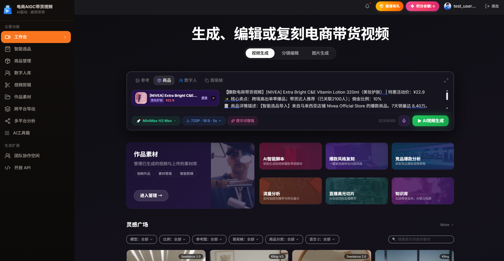
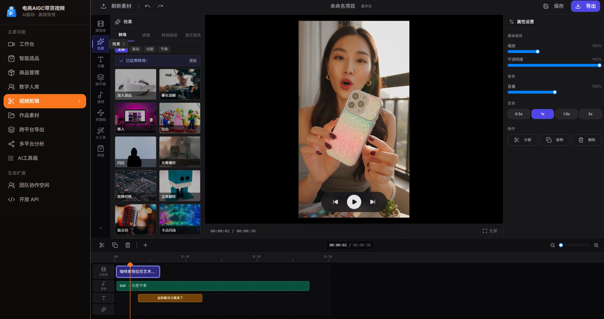

<div align="center">

# 🛒 Shopro AI

### 电商 AIGC 带货视频创作 SaaS 平台 —— 一人 + 浏览器，量产爆款带货短视频

[](https://react.dev)
[](https://www.typescriptlang.org)
[](https://vitejs.dev)
[](https://tailwindcss.com)
[](https://ui.shadcn.com)
[](https://vuejs.org)
[](https://element-plus.org)
[](https://supabase.com)
[](https://fastapi.tiangolo.com)
[](https://modelcontextprotocol.io)
[](https://pnpm.io)
[](./LICENSE)

🌐 **在线 Demo**：<https://f.playe.top> ｜ 📄 [项目评分分析](./评分.md) ｜ 🧪 [测试用例与结果](./doc/TEST_CASES.md)

</div>

---

## 📋 项目简介


**Shopro AI** 是面向抖音 / TikTok / 小红书 / Amazon 等电商平台的 **AIGC 带货短视频一站式 SaaS 创作平台**，通过多模态大模型与全链路智能工作流，打通「**商品输入 → 脚本生成 → 数字人合成 → 视频渲染 → 跨平台发布 → 数据回流**」的商业闭环，将传统「文案 + 拍摄 + 剪辑 + 翻译 + 运营」五人工作流压缩为「一人 + AI」：

- 💸 **极致降本**：单条视频综合成本 < 1 元（10 积分 = 1 元）
- ⚡ **极速出片**：3~5 分钟产出一条成品带货视频
- 📊 **数据驱动**：ROI 预测 + A/B 测试 + 投放数据回流自学习
- 🏢 **双端企业级**：商家创作端（React）+ 厂商运营中台（Vue）+ MCP 开放生态（Python）

> 🗺️ 全景参考：[系统架构图](./doc/system_architecture.svg) ｜ [Agent 工作流图](./doc/agent_workflow.svg)

---

## 🛠️ 技术栈

### 🎨 前端（商家创作端 + 厂商运营后台）

| 类别 | 技术选型 | 说明 |
|---|---|---|
| 核心框架 | React 18.3 + TypeScript 5.7（商家端）· Vue 3.5 + TS（运营端） | 双端解耦，强类型约束 |
| 构建工具 | Vite 5.4（SWC 编译）+ Manual Chunks 分包 | 极速 HMR 与按需懒加载 |
| UI 体系 | TailwindCSS 3.4 + Radix UI（shadcn 风格）+ Element Plus 2.9 + framer-motion | 原子化布局、玻璃态双主题、高精度动效 |
| 状态与数据 | @tanstack/react-query 5 + Context（商家端）· Pinia（运营端） | 异步缓存、乐观更新、Auth 会话 |
| 路由 | react-router-dom 6（受保护路由 + 懒加载） | 43 个页面模块 |
| 数据可视化 | Recharts（商家端）+ ECharts（运营端） | 流量看板、漏斗图、履约趋势 |
| 流式渲染 | SSE + eventsource-parser | AI 脚本打字机输出 |
| 代码质量 | Biome + tsgo 类型检查 + 自定义规则校验（`.rules/`） | Lint / 格式化 / 构建自检管线 |

### ⚙️ 后端与数据层

| 类别 | 技术选型 | 说明 |
|---|---|---|
| BaaS 云服务 | Supabase（Auth / PostgreSQL / Storage / Edge Functions） | 商家端全栈托管，Deno 边缘计算 ×23 个微函数 |
| 数据库 | PostgreSQL + RLS 行级安全 + pgvector 向量检索 | 26 个迁移脚本；原子扣费 RPC + `credit_logs` 审计 |
| 认证授权 | Supabase Auth / JWT · 手机验证码 + 邮箱登录 · RBAC | 团队空间与角色权限 |
| AI 代理服务 | Python / FastAPI（ASGI，Vercel Serverless） | `api/dxkp.py`、`api/mcp.py` 第三方模型密钥隔离透传 |
| 开放协议 | Model Context Protocol（Python FastMCP） | 7 大 AI 工具封装，HTTP/SSE + stdio 双传输，Docker 部署 |
| 支付集成 | 支付宝 AI 付（网站支付）+ 微信支付 Webhook | 下单 / 回调验签 / 查单 / 退款全链路 Edge Functions |
| 文件存储 | Supabase Storage + CDN | 视频成片、首帧封面、数字人形象、素材库 |
| 部署 | Vercel（前端 + Python 函数）+ Supabase 云端托管 | `vercel.json` 网关代理重写 + SPA fallback |

### 🤖 AI 服务矩阵

| 能力域 | 主通道模型 | 备份 / 降级链 | 用途 |
|---|---|---|---|
| 🧠 文本 / 脚本 | GLM-5.3-Flash（Sophnet）· DeepSeek-V4-Flash | dxkp.ai → SiliconFlow → 文心一言 | CoT 四层脚本、卖点提取、翻译、竞品分析、内容审核 |
| 🎙️ 语音合成 | CosyVoice2-0.5B（SiliconFlow） | StepAudio · MiniMax 音频 | 50+ 语种情感配音 |
| 🎤 语音识别 | TeleSpeechASR | — | 口播录音转写、直播高光识别 |
| 🎬 视频生成 | Seedance 2.0 Mini（Tokendance 网关） | MiniMax H3 · Wan3.0 Prime · HappyHorse 1.1 · Kling V3 · Sora | 首尾帧 + 声轨异步渲染 |
| 🖼️ 图像生成 | Flux 1.1 Pro | SiliconFlow 图像通道 | AI 封面候选、数字人形象克隆 |
| 🔎 向量嵌入 | Ada-002 Embedding（pgvector 存储） | — | 知识库 RAG 高分脚本 Few-shot 增强 |

---

## 📁 目录结构

```
Shopro/
├── src/                              # 🎨 商家创作端（React 18 + TypeScript + Vite）
│   ├── pages/                        #    43 个功能页面（react-router 懒加载 + 受保护路由）
│   │   ├── HomePage.tsx              #    ├─ 🏠 工作台：DashboardPage · TaskQueuePage · NotificationsPage
│   │   ├── VideoCreatePage.tsx       #    ├─ 🎬 创作主链路：ScriptPage · VideoEditPage · WorksPage
│   │   ├── ScriptPage.tsx            #    │    · BatchCreatePage（批量）· TemplatesPage · CoverCandidates
│   │   ├── ProductsPage.tsx          #    ├─ 🛍️ 商品与选品：ProductSelectionPage · CompetitorPage
│   │   ├── AvatarsPage.tsx           #    ├─ 🎭 数字人与音频：EmotionAnalysisPage · MultiLangPage
│   │   ├── CreditsPage.tsx           #    ├─ 💳 积分与支付：OrderDetailPage · AlipayReturnPage · InvitePage
│   │   ├── AnalyticsPage.tsx         #    ├─ 📊 数据与增长：ABTestPage · DataFeedbackPage
│   │   │                             #    │    · DataDashboardPage · TrendingPatternsPage · LiveHighlightPage
│   │   ├── TeamSpacePage.tsx         #    ├─ 👥 团队与开放：OpenAPIPage · KnowledgePage · PromptTemplatesPage
│   │   ├── AiToolboxPage.tsx         #    ├─ 🧰 AI 工具箱：StyleCopyPage · PersonalizePage · LLMCachePage
│   │   │                             #    │    · ActivitiesPage · ExportFormatsPage · MaterialsPage
│   │   ├── LandingPage.tsx           #    ├─ 🌍 门面与账号：LoginPage · ProfilePage · ForbiddenPage · NotFound
│   │   └── ...（PublishPage · Index.tsx 等）
│   ├── components/                   #    UI 组件层
│   │   ├── ui/                       #    ├─ 57 个 shadcn/Radix 原子组件（dialog/select/sidebar/toaster…）
│   │   │   ├── GlassCard.tsx         #    │    + 自研：玻璃态卡片 · 磁吸按钮 · 动态背景 · 脚本卡片
│   │   │   └── platform-icons.tsx    #    │    + 多平台图标（抖音/TikTok/小红书/Amazon…）
│   │   ├── common/                   #    ├─ 业务弹窗：CustomModelDialog（Portal 顶层化）
│   │   │   └── PaymentDialog.tsx     #    │    · PaymentDialog 充值 · PlatformCredentialDialog 平台凭证
│   │   ├── layouts/MainLayout.tsx    #    ├─ 主布局：侧边导航 + 移动端底部 Tab + 更多抽屉 + 安全区
│   │   ├── Navbar.tsx / Footer.tsx   #    ├─ 官网区块：HeroSection · PricingSection · StatsSection 等
│   │   ├── PlanGate.tsx              #    ├─ 套餐门禁：按 plan 拦截付费功能入口
│   │   └── UrlProductImportDialog.tsx#    └─ URL/口令商品导入弹窗
│   ├── api/                          #    Supabase 客户端封装
│   │   ├── client.ts                 #    ├─ ky HTTP 基座 + 请求约定
│   │   ├── products.ts               #    ├─ 商品 CRUD 与 URL/口令解析
│   │   ├── video.ts                  #    ├─ 视频任务提交/轮询/多模型网关适配
│   │   ├── credits.ts                #    ├─ 积分余额、原子扣费 RPC、流水读取
│   │   └── alipay.ts                 #    └─ 支付宝 AI 付下单与回跳
│   ├── lib/                          #    模型网关 SDK 与核心工具
│   │   ├── minimax/ · wan3/          #    ├─ Tokendance 视频网关 SDK：MiniMax H3 · Wan3.0 Prime
│   │   ├── seedancemini/ · happyhorse/#   ├─ Seedance 2.0 Mini · HappyHorse 1.1（DashScope 异步协议）
│   │   ├── vectrust/                 #    └─ Vectrust 通道
│   │   ├── creditGuard.ts            #    ⚡ 余额不足前置拦截（弹窗 + 生成阻断）
│   │   ├── sse.ts                    #    ⚡ SSE 流式解析（打字机输出）
│   │   ├── customModel.ts            #    ⚡ 自定义模型配置（BYOK）
│   │   ├── videoFrame.ts             #    ⚡ 首帧截取（作品真实封面）
│   │   └── audioRecorder.ts · utils.ts
│   ├── contexts/AuthContext.tsx      #    认证会话（Supabase Auth + 短信/邮箱登录）
│   ├── hooks/                        #    useCredits（全站余额广播）· useDraft · use-toast · use-mobile
│   ├── services/audio/index.ts       #    音频服务抽象（TTS/ASR 统一入口）
│   ├── types/                        #    route.ts · types.ts（ScriptScene/StyleReport 等领域类型）
│   ├── db/supabase.ts                #    Supabase 连接层
│   └── App.tsx · main.tsx · index.css #    路由装配 · 入口 · 主题（暗/亮玻璃态）
├── backend/                          # 🏢 厂商运营中台（Vue 3 + Element Plus + Pinia + ECharts + MSW）
│   ├── index.html · vite.config.ts   #    独立 Vite 子工程（vue-tsc 构建自检）
│   ├── admin-architecture-spec.md    #    中台架构规格说明书
│   └── 项目结构与功能模块说明.md       #    多租户/风控/调账/Attempt 追踪模块说明
├── supabase/                         # ☁️ BaaS 云服务
│   ├── functions/                    #    ⚡ 23 个 Edge Functions（Deno）
│   │   ├── ai-assistant/             #    ├─ 视频生成主编排（脚本/增强/提交/退款）
│   │   ├── deepseek-v4-pro/ · glm-5-3-flash/# ├─ 文本主通道与降级链（+ wenxin · minimax-chat）
│   │   ├── seedance/ · kling-video-*/ · sora-video-*/ # ├─ 视频生成提交与查询
│   │   ├── siliconflow-audio/ · stepaudio/    # ├─ TTS 情感配音 / ASR 转写
│   │   ├── alipay-payment-order|notify/ · alipay-trade-query|ops/ # ├─ 支付宝 AI 付四件套
│   │   ├── create-payment-order/ · wechat-payment-webhook/ # ├─ 微信/通用支付
│   │   ├── send-sms-code/ · verify-sms-code/  # ├─ 短信认证
│   │   ├── phase3-assistant/ · setup-demo/    # ├─ 开放平台助手 · 演示数据
│   │   └── _shared/                  #    └─ 共享工具（鉴权/密钥读取/审计，缺失密钥返回 503）
│   ├── migrations/                   #    🗄️ 26 个增量迁移（00001 认证建表 → 00009 扣费 RPC
│   │   └── ...                       #    → 00022 RLS 加固+统一退款 RPC → 00023 AI 治理
│   │                                 #    → 00025 积分端到端口径 → 00026 支付宝网站支付）
│   ├── schema.sql                    #    全量表结构 + RLS + RPC + 触发器基线
│   └── config.toml                   #    项目配置
├── api/                              # 🐍 FastAPI 无服务器代理（Vercel Python Functions）
│   ├── dxkp.py                       #    dxkp.ai 模型网关 ASGI 透传（密钥隔离）
│   └── mcp.py                        #    MCP Streamable HTTP JSON-RPC 网关
├── mcp/                              # 🔌 MCP 开放生态（Python FastMCP）
│   ├── mcp_server.py · mcp_shopro_server.py        # HTTP/SSE 传输服务（Shopro 版/通用版）
│   ├── mcp_server_stdio.py · mcp_shopro_server_stdio.py # stdio 本地智能体接入
│   ├── tools.json                    #    7 大 AI 工具契约（卖点/脚本/翻译/TTS/增强/提交/查询）
│   └── Dockerfile.mcp · docker-compose.mcp.yml     # 容器化部署
├── doc/                              # 📚 项目文档
│   ├── system_architecture.svg       #    系统架构图（五层全景）
│   ├── agent_workflow.svg            #    Agent 工作流图（决策分支 + 工具链路）
│   ├── TEST_CASES.md                 #    23 个测试用例与实测结果
│   ├── ALIPAY_AIPAY_INTEGRATION.md   #    支付宝 AI 付接入文档
│   ├── 支付.md · 竞品.md              #    支付方案与竞品调研
│   └── fx.md · fx1.md                #    功能分析与改进建议（前端/后端/AI 三张表）
├── scratch/                          # 🧪 16 个真实 API 联调探针（minimax/seedance/wan3/glm/
│                                     #    happyhorse 各通道实测脚本，可复验 AI 调用真实性）
├── public/                           # 🖼️ 静态资源（Video 模板与封面 · covers · shop 商品图 · person）
├── .rules/ · .agents/                # ✅ 自定义质量规则（Biome yml 规则 + lint/test 脚本）与 Agent 规范
├── clipforge/ · skill-creator/       # 🧩 附属子模块（视频剪辑引擎 / Skill 工具链）
├── vercel.json                       # 🚀 部署配置：AI 网关代理重写 + SPA fallback
├── vite.config.ts · vite.config.dev.ts # 构建配置（SWC + Manual Chunks；dev 代理 gmicloud/dxkp/glm）
├── tailwind.config.js · components.json # 样式与 shadcn 配置
├── biome.json · sgconfig.yml · tsconfig.* # 代码质量与类型检查配置
├── .env.example                      # ⚙️ 环境变量模板（Supabase + 各 AI 网关 + 支付宝密钥说明）
├── PRD.md · AGENTS.md                # 📑 产品需求文档 v2.0 · 协作规范
├── 评分.md · 加分.md                  # 🏆 比赛评分分析与加分项交付清单
├── LICENSE                           # ⚖️ MIT 开源协议
└── package.json · pnpm-lock.yaml     # 📦 依赖与脚本（dev/build/lint）
```

> 📌 说明：`backend/`（运营中台）与根目录（商家端）为两个独立 pnpm 工程；`src/pages` 树中仅列代表性文件，完整 43 个页面以目录实际为准。

---

## ⚡ 核心功能模块与工作流程

### 🧩 功能模块总览

| 模块群 | 功能页面 | 核心能力 |
|---|---|---|
| 🏠 工作台与总览 | HomePage · DashboardPage · TaskQueuePage | 今日生成数 / 积分消耗 / ROI 概览 / 全局搜索 / 消息中心 |
| 🎬 视频创作主链路 | VideoCreatePage · ScriptPage · VideoEditPage · WorksPage | 向导式生成 · CoT 四层脚本 SSE 流式 · Canvas 多轨道分镜剪辑 · 作品自动入库与首帧封面 |
| 🛍️ 商品与选品 | ProductsPage · ProductSelectionPage · CompetitorPage | 抖音/淘宝/Amazon URL 与口令解析 · 16 国爆款选品矩阵 · 竞品风格 DNA 复刻 |
| 🎭 数字人与音频 | AvatarsPage · EmotionAnalysisPage · MultiLangPage | 数字人选择与照片克隆 · CosyVoice2 情感配音 · 情绪时间轴对齐 · 50+ 语种翻译 |
| 💳 积分与支付 | CreditsPage · OrderDetailPage · AlipayReturnPage | 余额前置拦截 creditGuard · 原子扣费 + `credit_logs` 审计 · 支付宝 AI 付 / 微信充值闭环 |
| 📊 数据与增长 | AnalyticsPage · ABTestPage · DataFeedbackPage · TrendingPatternsPage | 多平台投放分析 · A/B 版本淘汰 · 低效文案 AI 重写回流 |
| 👥 团队与开放 | TeamSpacePage · InvitePage · OpenAPIPage · KnowledgePage | 团队空间 RBAC · 资源共享 · `ak_` API 密钥与沙箱调试 · pgvector RAG 知识库 |
| 🏢 厂商运营中台 | backend/（Vue） | 多租户管理 · AI 任务 Attempt 级追踪与故障退款 · 内容风控 · 积分调账 |

### 🔄 视频生成主工作流

```
商品 URL/口令 ──▶ ① AI 解析卖点 ──▶ ② CoT 四层脚本生成（钩子→痛点→产品→CTA，SSE 流式）
                                        │  ↳ 可选：pgvector RAG 高分脚本 Few-shot 增强
                                        ▼
                 ③ 数字人 + CosyVoice2 情感配音（50+ 语种）
                                        ▼
        ◆ ④ creditGuard 余额校验（≥10 积分？）── 不足 ──▶ 充值弹窗（支付宝/微信）──▶ 到账重校验
                                        │ 充足
                                        ▼
                 ⑤ 原子扣费 RPC（-10 积分 + credit_logs 流水）
                                        ▼
                 ⑥ Seedance 异步渲染提交 ──▶ ◆ 任务状态轮询
                                        │            │ 失败 → Attempt 指数退避重试 → 耗尽自动退款冲正
                                        ▼ 成功
                 ⑦ 首帧封面截取 + Flux 多封面候选 → 作品自动入库
                                        ▼
                 ⑧ 多轨道剪辑 → 跨平台导出发布 → ⑨ ROI/A-B 数据回流 → 低效文案 AI 重写（回到 ②）
```

> 🖼️ 可视化版本见 [doc/agent_workflow.svg](./doc/agent_workflow.svg)；外部 AI Agent 可经 MCP Server（`tools.json` 契约 + `ak_` 密钥）复用同一真实扣费/审计工具链。

---

## ⚙️ 部署指南

### 🔧 环境要求

| 依赖 | 版本要求 |
|---|---|
| Node.js | ≥ 18.3.1 |
| pnpm | ≥ 10.34.5 |
| 浏览器 | 现代主流浏览器（支持 WebRTC / SSE） |
| Supabase CLI | 用于部署 Edge Functions 与注入 Secrets |

### 🚀 快速启动（商家创作端）

```bash
# 1. 克隆仓库并安装依赖
git clone https://gitee.com/xiaoye66/shoproai.git
cd Shopro && pnpm install

# 2. 配置环境变量（Supabase 连接 + 各 AI 网关密钥）
cp .env.example .env    # 填入 VITE_SUPABASE_URL / VITE_SUPABASE_ANON_KEY 及各 VITE_*_API_KEY

# 3. 开发调试（默认 http://127.0.0.1:8080）
pnpm dev

# 4. 生产构建与质量自检
pnpm build              # vite build 产出 dist/
pnpm lint               # 类型检查 + Biome + 自定义规则 + 构建自检
```

### ☁️ 后端与云服务部署

```bash
# 1. 数据库：初始化表结构 / RLS / 原子扣费 RPC / 触发器
supabase db push                          # 或手动执行 supabase/schema.sql 与 migrations/
                                          # ⚠️ 托管 Supabase 上 git push 不会自动应用迁移，需手动执行 SQL

# 2. Edge Functions：部署 23 个微函数
supabase functions deploy                 # 或按目录逐个 deploy（seedance / alipay-payment-order / …）

# 3. 密钥注入：一律通过 secrets 注入，缺失时相关函数返回 503（无明文兜底）
supabase secrets set GLM_API_KEY=xxx DEEPSEEK_API_KEY=yyy SILICONFLOW_API_KEY=zzz \
  SEEDANCE_API_KEY=... ALIPAY_APP_ID=... ALIPAY_PRIVATE_KEY=... ALIPAY_PUBLIC_KEY=... \
  ALIPAY_GATEWAY=https://openapi.alipay.com/gateway.do ALIPAY_SITE_URL=https://your-domain \
  ALIPAY_NOTIFY_URL={SUPABASE_URL}/functions/v1/alipay-payment-notify
```

### 🌐 前端上线（Vercel）

```bash
npm i -g vercel && vercel --prod   # vercel.json 已配置 AI 网关代理重写与 SPA fallback
```

> ✅ 线上实例：<https://f.playe.top>（`/glm-api`、`/siliconflow-api`、`/tokendance-api`、`/openai-next-api`、`/dxkp-api` 代理规则已生效）

### ️ 厂商运营后台 & 🧪 MCP 服务

```bash
cd backend && pnpm install && pnpm dev          # Vue 3 运营中台（含 MSW 演示模式）

cd mcp && pip install -r requirements_mcp.txt   # MCP 开放生态
python mcp_shopro_server_stdio.py               # stdio 模式（本地智能体接入）
docker compose -f docker-compose.mcp.yml up     # 或容器化 HTTP/SSE 模式对外提供
```

---

## 📦 API 接口总览

### ⚡ Supabase Edge Functions（Deno，`{SUPABASE_URL}/functions/v1/{name}`）

| 分组 | 端点 | 方法 | 职责 |
|---|---|---|---|
| 🧠 AI 编排 | `ai-assistant` | POST | 视频生成主编排：脚本/提示词增强/任务提交/失败退款 |
| | `phase3-assistant` | POST | 开放平台助手：API 密钥签发与沙箱调试 |
| | `deepseek-v4-pro` · `glm-5-3-flash` · `wenxin-text-generation` · `minimax-chat` | POST | 文本大模型通道（主通道 + 降级链） |
| | `seedance` | POST | Seedance 视频/封面异步生成与轮询 |
| | `kling-video-create` · `kling-video-query` | POST/GET | Kling 视频任务提交与状态查询 |
| | `sora-video-create` · `sora-video-query` | POST/GET | Sora 视频任务提交与状态查询 |
| | `siliconflow-audio` · `stepaudio` | POST | TTS 情感配音 / ASR 转写 |
| 💳 支付收单 | `alipay-payment-order` | POST | 支付宝 AI 付网站支付下单（返回 form 表单跳转） |
| | `alipay-payment-notify` | POST | 异步回调验签 → 积分入账 |
| | `alipay-trade-query` · `alipay-trade-ops` | POST | 交易查询 / 退款等操作（回调缺省时的兜底对账） |
| | `create-payment-order` · `wechat-payment-webhook` | POST | 微信/通用支付订单与回调 |
| 🔐 认证 | `send-sms-code` · `verify-sms-code` | POST | 手机验证码发送与校验 |
| 🛠️ 运维 | `setup-demo` | POST | 演示数据初始化 |

### 🐍 FastAPI 无服务器代理（Vercel `/api/*`）

| 端点 | 方法 | 职责 |
|---|---|---|
| `/api/dxkp` | ALL | dxkp.ai 模型网关透传（密钥隔离，前端经 `/dxkp-api` 重写访问） |
| `/api/mcp` | POST | MCP Streamable HTTP 网关（智能体 JSON-RPC 接入） |

### 🔌 MCP 开放工具（`mcp/tools.json` 契约，7 大工具）

| 工具 | 功能 |
|---|---|
| `extract_product_highlights` | 商品卖点结构化提取 |
| `generate_marketing_script` | CoT 四层营销脚本生成 |
| `translate_marketing_script` | 多语种本地化翻译 |
| `synthesize_voice_tts` | 情感语音合成 |
| `enhance_prompt` | AI 提示词增强 |
| `submit_video_generation` | 视频生成任务提交 |
| `query_video_status` | 任务状态轮询查询 |

### ️ 前端客户端封装（`src/api/`）

| 模块 | 职责 |
|---|---|
| `client.ts` | ky HTTP 基座 + Supabase 请求约定 |
| `products.ts` | 商品 CRUD 与 URL/口令解析 |
| `video.ts` | 视频任务提交 / 轮询 / 多模型网关适配 |
| `credits.ts` | 积分余额查询、原子扣费 RPC、流水读取 |
| `alipay.ts` | 支付宝 AI 付下单与回跳处理 |

> 📄 数据库层 RPC（`supabase/schema.sql`）：原子扣费 / 退款冲正函数 + `credit_logs` 审计表 + 新用户注册赠分触发器，全部受 RLS 行级安全保护。

---

## 💡 总结与展望

###  项目总结

Shopro AI 是一个**已完成商业闭环验证的全栈 AIGC 实战项目**：43 个页面的商家创作端与 Vue 运营中台双端并行，23 个 Edge Functions 承载真实 AI 编排与支付链路，积分体系从「注册赠分 → 前置拦截 → 原子扣费 → 失败退款 → 充值入账」全链路可审计，AI 能力全部为真实第三方模型调用（`scratch/` 16 个探针脚本可复验），并已部署于 <https://f.playe.top> 对外可用。

**技术亮点**：
- 🧠 CoT 四层营销脚本 + SSE 打字机流式 + pgvector RAG Few-shot 自进化
- 🏗️ 主备模型网关矩阵（GLM/DeepSeek 文本、Tokendance 视频、SiliconFlow 音频）与 400 静默降级的前端兜底治理
- 💳 支付宝 AI 付 + 微信支付真实收单，密钥治理（Edge Secrets 注入、缺失返回 503、无明文兜底）
- 🎞️ 视频编辑器 rAF + video 原生时钟主驱动、Blob 预载缓存、60FPS 游标渲染的性能重构
- 🔌 MCP 开放生态：智能体与商家端共用同一真实扣费/审计工具链

### 🔭 未来展望

| 方向 | 规划 |
|---|---|
| 🤝 平台直连 | 接入抖音/TikTok 开放平台 API 实现真正的账号级一键发布与数据回流 |
| 📈 模型进化 | 引入流量预测微调模型，A/B 淘汰策略升级为自动化投放 Agent |
| 👥 企业能力 | 厂商中台落地 Spring Boot 生产 REST、多租户计费与私有化部署交付包 |
| 🧩 生态开放 | MCP 工具市场化合规审核与配额计费，孵化第三方创作者插件生态 |
| 🌍 出海纵深 | 扩充小语种情感配音评测集，建设分国别爆款脚本知识库 |

---

<div align="center">

**⭐ 如果这个项目对你有帮助，欢迎 Star 支持！**

MIT License · Copyright (c) 2026 Shopro AI ([xiaoye66](https://gitee.com/xiaoye66/shoproai))

</div>
