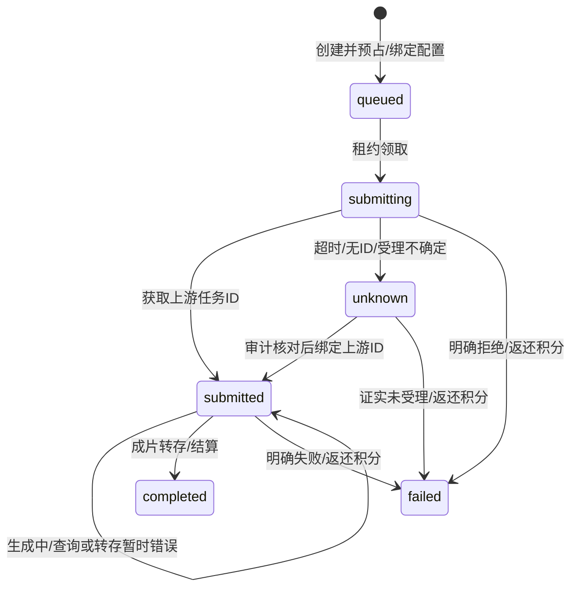

# 接口与数据契约

更新：2026-10-22，功能基线`d7e3d38`，当前00062/probe22/render4/edit2，MCP59/19。完整功能清单见 [发布基线](RELEASE_BASELINE_20261022.md)。

## 历史协议增量

以下按各轮记录保留；当前通用、模型、数据和新增契约见后文。旧probe/数量不用于最新版接入。

最新 [迭代34](ITERATION_34_IMAGE_EDITING.md)：image请求新增mode、mask_image、confirmed_credit_cost/confirmed_model_version；00062在扣费前校验原价/原配置/私有存储对象，同UUID恢复原任务。image.primary增加可选同域edit_endpoint，catalog只提供image_capabilities/version_id。编辑发送官方images/mask JSON数据URL；PNG实际解压有界校验，非法原图和掩码拒绝。image_editing_schema_ready为service-only，probe22/00062，render4/edit2保持；下文按历史时点阅读。

上一轮 [迭代33](ITERATION_33_CREDITS_SMS.md)：00061新增get_my_credits()，固定auth.uid返回余额、有效/配置等级、状态、到期/周期、服务端时间；缺账号报错，管理员仍查本人。account_credits_schema_ready为service-only。页面共用账号查询，生成前回源；通知POST固定原账号，SMS独立验证回执后登录。

当前 [迭代31](ITERATION_31_ACCOUNT_STORYBOARD.md)：00059新增authenticated-only `get_my_profile_overview(p_timezone)`，无用户ID参数，返回本人videos/completed/materials/products/published和30个日期/计数；已发布按publish_tasks实际published计数。service-only `profile_overview_schema_ready()`供probe19核对头像引用触发器。脚本与知识写入持久原UUID并核对原内容，资料读取不创建账号。render4/edit2保持。

前一轮 [迭代30](ITERATION_30_WORKS_LIBRARY.md)：material-assets list增加search（0–200字符，字面名称匹配），offset/limit/type和当前用户范围保持。作品与首页参考上传统一原UUID/register/使用权；私有下载读取真实文件。

当前 [迭代29](ITERATION_29_ALERTS_RECOVERY.md)：operations list新增alerts，返回monitor.last_scan_at/stale和每条can_ack；mutate alert_ack需alert_id/expected/reason/原request_key，沿原对象权限与客户范围核对，恢复前仍验证当前权限。production-worker monitor只接受后台专用密钥和scheduler_healthy真实布尔，返回active/opened/resolved/observed_at，不领取业务任务。00057统一扣费锁序，00058告警/事件/心跳，probe18/00058/render4/edit2；前端/调度/发布工具同窗升级。

新增 [迭代26](ITERATION_26_EDITOR_ASSETS.md)：material-assets POST list(offset/limit/type)/register(request_key/input)，只接受用户JWT，服务端生成本人路径/稳定引用；Storage大小/MIME核对、material_upload_receipts原请求/使用权时间与删除墓碑。render4新增eqBands(十频段/-12至12dB)、echo(0–100)、voiceEffect(none/robot)。MCP新增get_edit_prices/submit_edit_analysis，保留原片段/价格/UUID/本人工程，创建使用render:create、价格读取使用jobs:read；目录58工具/18权限，probe15/00054/render4/edit1。以下迭代描述为历史时点。

新增 [迭代25](ITERATION_25_EDIT_ANALYSIS.md)：production-jobs/edit-prices与create(kind=edit_analysis)，原UUID/确认价格/mode/source{id,type,url,start,duration,sourceStart,speed}/可选本人工程；JWT或render:create Key，query/list沿jobs:read。原回执返回edit_request，字幕结果segments/asr_version，节拍beats/bpm/confidence/algorithm/source_hash。render3新增personMask固定版本/阈值/平滑与色键互斥，edit_prepare须edit_version=1；probe14/00053/render3/edit1同窗。MCP未增加独立音轨创建工具。

新增 [迭代24微信契约](ITERATION_24_WECHAT_TRANSACTIONS.md)：wechat-trade-ops POST query/close（本人或客户范围内财务）和refund/refundQuery/receipt（可信财务、原UUID/原申请）；8KB/30次每分钟，微信浏览器核对55秒超时。wechat-refund-webhook使用原文RSA/AES-GCM鉴权，非JWT。00052新增原商户/订单租约/支付截止、渠道退款ID和统一权益函数；PROCESSING/ABNORMAL/unknown保留预占，签名SUCCESS才入账、CLOSED结案。probe13/00052/render2，两个新入口与匹配全栈同窗发布。

新增 [迭代23](ITERATION_23_DATA_LIFECYCLE.md)：production-jobs/revoke-voice接受voice_clone_id/request_key，当前JWT或audio:create Key绑定用户，503保留原请求、同键换声纹409；voices返回撤销/删除时间。knowledge-base/delete接受entry_id，knowledge:write Key或JWT，撤销浏览器直删权限；重复条目删除可恢复。00051新增引用索引、媒体/声纹租约及清理回执、source_erased_at和晚到知识过滤；probe12/00051/render2，需同窗前后端发布。

新增 [迭代22收银契约](ITERATION_22_CHECKOUT_LOADING.md)：微信/支付宝创建POST必须个人JWT及plan_id/request_key/expected_amount两位小数文本/expected_credits整数；00050按账号原UUID恢复，价格/积分/原参数409、待支付配额429、账号403、unknown503保留原回执。终态不重收款；服务端入账仍沿原验签事务。客户端账单/订单仅本人SELECT，资金不对Key开放；probe v11/00050/render2，需前后端同窗发布。

新增 [迭代21契约](ITERATION_21_TRANSLATION_NOTIFICATIONS.md)：product-management translations返回20条任务/cost，translate原UUID与商品ID/expected_updated_at/目标语言/主图布尔/确认价格，202及unknown恢复。eBay图片目标绑定稳定私有image_url/image_hash/market；analysis的competitor_reference包含本人sample_id/item_id/rights_confirmed:true，由DB读取真实统计。read_notifications/mutate_notifications为本人authenticated RPC，分类/25页/服务器cutoff/偏好/RLS；API Key不开放。probe v10/00049，MCP54工具/18权限。

新增 [现金/运营契约](ITERATION_20_CASH_OPERATIONS.md)：operations POST access/list/mutate（个人JWT、可信角色/客户范围、25条分页、预算原版本/UUID、授权撤销审计）；alipay-trade-ops新refund必须原UUID/金额/原因、refundQuery/receipt支持原UUID或out_request_no、unknown保留预占/202/503恢复。00047/00048事务绑定到账签名/金额/原编号与权益；用户仅cash_refund_receipts只读。两入口8KB正文，运营60/资金30请求每分钟，浏览器25秒；后台只查询原退款。probe v9/00048，资金接口不接受MCP/API Key。

新增 [商品管理契约](ITERATION_19_PRODUCT_MANAGEMENT.md)：product-management的list/imports/extract/save/delete；products:read/write权限、1MB正文、60请求/分钟、1–100条原子操作。00046新增来源、原币种、生成价格列、可空库存/销量、只读浏览器商品、版本检查与哈希回执；受理未知503保留原UUID。后台任务与MCP52工具共用，目标待部署。

00045新增 [发布组契约](ITERATION_18_PUBLISH_GROUPS.md)：platform-publish/create_group接受原UUID、project_id、稳定source_url/真实duration、内容/时间与1–10个targets，各target完整options/consent。publish:create创建、publish:read/query_group核对；202返回组与独立任务，list新增20组/100任务。409明确区分publish_group_rejected与publish_group_conflict，超时503保留原键。组表/RPC仅服务身份可用，API绑定当前用户。

新增 [MCP与Key契约](ITERATION_17_MCP_PRODUCTION.md)：45工具定义由真实SDK导出，媒体create强制工具层UUID/confirmed_credit_cost。16权限共用目录；knowledge-base读/写、market-intelligence读/写、platform-publish取消/指标同步和platform-accounts安全读取接入Key范围，账号授权/撤销/应用设置仍JWT。错误脱敏并保留原键，不自动重发POST。完整参数见[MCP指南](../mcp/mcp.md)。

render v1增量见 [迭代16](ITERATION_16_RENDER_EFFECTS.md)：十二transition标识、可选transitionDuration(0.02–2s)，视觉轨blendMode八模式、chromaKey六位RGB/容差0.01–1/平滑0–1。前后交接按时长收缩，不延长工程；转场主轨不得重叠，画中画可叠加。API/Worker双校验，沿原production-jobs/request_key/私有引用提交；项目整数duration上取整，style_data保存精确时长。

00044新增 [market-intelligence契约](ITERATION_15_MARKET_INTELLIGENCE.md)：JWT POST、16KB/60次每分钟、catalog/save_target/collect/schedule/import_product/delete。collect固定request_key/target_id/confirmed_credit_cost，schedule另有request_key/runs/budget；数据库事务隔离、相同UUID重放不重复扣费/重启计划。只读供应商GET及eBay应用OAuth，结果有来源版本、观测时间/定义和空指标，不回传凭据；原phase3竞品入口410。

00043新增 [knowledge-base与索引契约](ITERATION_14_KNOWLEDGE_RETRIEVAL.md)：JWT POST，catalog/query关键词、jobs、context(job_id)、create(kind=knowledge_index/search,request_key,input)。索引input={entry_id,content_hash,confirmed_credit_cost}；查询input={query,limit,confirmed_credit_cost}。正文上限64KB，90次/分钟，限流故障拒绝；400参数/402积分/409版本价格幂等/424配置/429队列/503依赖。Embedding数据仅服务端；生产任务公开结果不包含向量/凭据。旧knowledge_rag_search无任务标识410；text-generation/四层脚本可传knowledge_job_id，服务端核验引用。

00042契约见 [观测与实验接口](ITERATION_13_MEASUREMENTS_EXPERIMENTS.md)：measurements的report/experiments/sources/projects/advice-price可用metrics:read，实验写/来源管理只接受JWT且来源需管理员。measurement-ingest独立验证source/timestamp/HMAC原始正文；assign/events/daily固定request_key，128KB、500请求/分钟及整批回执。数据快照需revision与明确null，8种两位小数币种，CVR为转化/点击，ROAS扣退款。analyze_traffic需project_id/creative_brief/confirmed_credit_cost，服务端加入观测。旧ab变体写权限撤销。发布函数与00042一起启用。

增量00041：[素材分析契约](ITERATION_12_GROUNDED_ANALYSIS.md)。production-jobs新增analysis-price与create kind=analysis（video:create），input的mode/title/source_url/confirmed_credit_cost；查询含mode及源指纹/模型版本/可验证结果。专用Worker领取analysis_prepare并提交prepared，模型阶段权限隔离；旧风格/高光入口410。普通同步AI强制JWT身份及关联工程/商品归属校验。

当前官方成功证据仍00031/三旧函数，管理最近401，见 [当前状态](CURRENT_STATE.md)。接入须部署匹配00062全部依赖；示例UUID仅说明，实际使用自建原请求UUID。

## 1. 通用约定

业务 Edge API 基地址为 `${SUPABASE_URL}/functions/v1`。浏览器使用 SDK 登录后携带 `Authorization: Bearer <用户JWT>` 与项目公开 apikey；用户型接口拒绝 service_role 冒充用户。管理接口进一步检查 Auth 管理员身份。用户 CRUD 仍经 Supabase Data API，由 GRANT/RLS 限定本人数据。

JSON 请求使用 `Content-Type: application/json`，允许的预检由各函数处理。通常 400 表示参数/配置非法，401 未登录，403 无权限，402 视频积分不足，404 本人任务不存在，409 幂等/配置冲突，429 频控，503 运行错误或结果未确认。各接口具体状态以实现为准，不能把所有非 2xx 当作上游未受理。

受限Key按19种Action scope授权，MCP固定九业务入口；api-keys/team-space/material-assets/operations、支付、奖励/通知管理使用本人JWT或可信运营身份，Key不开放这些写入。网关例外以43入口manifest逐项核对，关闭网关JWT后函数仍必须验证JWT/Key/专用密钥/签名。旧phase3团队和密钥Actions返回410。

批量增量00038：`batch-video-jobs`支持quote/list/query（video:read）与create/pause/resume/cancel（video:create），JWT/Key共用身份。create传request_key、商品ID、统一规格/独立要求、确认单价和总预算；整批原子预占并复用video_jobs。query/list纯读取，终态与资金汇总子任务；取消仅释放未提交项。完整字段、错误状态和兼容见 [批量接口](ITERATION_09_BATCH_VIDEO.md)。

导出增量00039：production-jobs新增export（render:create）、query-export/exports（jobs:read）。export传request_key、source_project_id、formats[{ratio,height}]；源URL/时长由服务端读取。六画幅含4:5、三短边，最多18组合，全部输出作品/渲染任务同事务；24个未结案渲染共用配额，容量不足429。同键不同参数409，失联503保留原请求；query-export缺本人记录404。返回export包含独立jobs的规格/状态/结果，未返回原始输入或租约。完整兼容见 [多规格导出接口](ITERATION_10_RENDER_EXPORTS.md)。

媒体create支持tts/asr/voice_clone（audio:create）、avatar/lipsync（avatar:create），voices/media-prices需jobs:read；价变409/无配置424/10活跃配额429/未知503保留原回执。声纹原UUID撤销、供应商原版本删除见迭代23。production probe22要求00062/render4/edit2，不消费任务；旧probe2不可用于本次发布。

## 2. 视频任务

入口 [video-jobs](../supabase/functions/video-jobs/index.ts)，仅 POST：

```json
{
  "action": "create",
  "request_key": "11111111-1111-4111-8111-111111111111",
  "provider": "ArkSeedance",
  "input": {
    "prompt": "商品置于桌面，缓慢推进镜头展示材质",
    "duration": 5,
    "resolution": "720p",
    "ratio": "9:16"
  }
}
```

`provider` 允许 ArkSeedance、MiniMax、SeedanceMini、Wan3、HappyHorse、Kling、Seedance。规格及首尾帧/参考视频的互斥与支持范围由 [video-providers](../supabase/functions/_shared/video-providers.ts) 校验，不承诺每个模型支持所有参数。

| Action | 参数 | 返回与语义 |
| --- | --- | --- |
| `create` | `request_key` UUID、`provider`、`input` | HTTP 202 `{job}`；数据库创建、预占与版本绑定；不证明已提交供应商 |
| `query` | `job_id` 或 `request_key` UUID | `{job}`；限定本人；可能领取到期任务执行一次，**不是只读健康检查** |
| `list` | 无额外参数 | `{jobs}`；本人有扣费关联的最近 30 条，创建时间倒序；未提供分页游标 |

公开 `job` 字段为 `id/project_id/provider/status/submission_state/billing_state/credit_cost/progress/video_url/error_message/needs_attention/created_at`。不回传上游 ID、密钥、扣费流水 ID、租约或配置密文。

创建 503 或响应丢失：复用相同 UUID 与参数查询/创建找回。相同 UUID 不同参数 409；禁用模型不影响找回已有任务。确定失败后再次生成是新任务。

任务中心 `/task-queue` 使用上述list/query与production-jobs、platform-publish组合读取；不再查询历史job_type/input_data字段或直接删除video_jobs。平台发布按job_id去重，以publish_tasks审核状态为准，待提交取消调用既有platform-publish cancel。错误保留上次记录，未知受理不重发。契约与验证见 [任务中心迭代](ITERATION_07_TASK_CENTER.md)。

## 3. 状态与执行器

三个状态维度分开解释：

| 维度 | 值与含义 |
| --- | --- |
| `status` | 服务端主链路使用 `pending/processing/completed/failed`；00038增加批次内queued子任务的服务端cancelled，不支持取消已受理任务 |
| `submission_state` | `queued` 待领、`submitting` 提交在途、`submitted` 有上游 ID、`unknown` 受理待核对 |
| `billing_state` | `reserved` 已预占、`settled` 成功结算、`refunded` 原流水积分返还 |



入口 [video-job-worker](../supabase/functions/video-job-worker/index.ts) 只接受 POST 和 `Bearer VIDEO_WORKER_SECRET`：

- `{"action":"probe"}`：只验证队列所需字段，返回 `{ready:true,version:1}`；不领取、不调用模型，也不保证配置可解密或供应商可用。
- `{"action":"run"}`：最多处理一个任务，返回 `{processed:0|1}`；省略 action 也按 run 处理。

租约默认 180 秒，`FOR UPDATE SKIP LOCKED` 避免并发重复领取。先持久化终态证据再执行状态/退款事务；退款事务失败后可由租约恢复重试。长期查询退避并标记 `needs_attention`，不会仅凭等待时长退款。

## 4. 模型设置

入口 [model-settings](../supabase/functions/model-settings/index.ts)，仅 POST：

| Action | 身份/输入 | 输出 |
| --- | --- | --- |
| `catalog` | 登录用户 | `{configs,admin}`；槽、名称、类别、启用、视频 provider |
| `list` | 管理员 | 设置、`version_id/has_key/updated_at`；无明文/密文 |
| `save` | 管理员；`slot/settings/enabled/version_id/api_key` | `{version_id}`；首次版本传 null，后续传当前 ID；并发冲突 409 |
| `import` | 管理员；历史服务端 Secrets | `{imported,skipped}`；只补尚未保存的有效槽 |
| `test` | 管理员；`slot` | `{ok,status,latency_ms,message}`；保存的只读 GET，10 秒超时 |

`settings`字段为`name/protocol/endpoint/query_endpoint/edit_endpoint/model/auth_header/auth_scheme/timeout_ms/voice/test_endpoint`。20槽及协议见 [MODEL_SLOTS](../supabase/functions/_shared/model-catalog.ts)。catalog包含无秘密`version_id/image_capabilities`；edit_endpoint可选，OpenAI Images编辑须同域同images路径和受支持GPT Image模型。Key留空保留，版本不可改删；默认名称/只读test不证明生成权限。

## 5. 同步生成与兼容入口

| 入口 | 核心输入/返回 | 应用计费与边界 |
| --- | --- | --- |
| `text-generation` | `messages`、`stream`、`temperature`、`max_tokens`；真实 SSE/JSON | 暂不扣应用积分，20 次/用户/分钟；最多 30 消息、单消息 16000 字符、输出最多 8192 tokens |
| `image-generation` / `production-jobs` image | request_key、prompt/size/quality、mode/reference_image/mask_image、confirmed_credit_cost/confirmed_model_version；202 `{job}` | 默认10原流水；掩码编辑必须确认价格/版本，私有PNG实际验证；checkpoint归档不再生成 |
| `siliconflow-audio`、`stepaudio` | 历史同步入口 | 410迁移说明；改用production-jobs后台语音任务 |
| `production-jobs`媒体类型 | tts/asr/voice_clone/avatar/lipsync；202 `{job}` | 真实确认价格、版本与私有输出；默认2/2/10/10/10，详见迭代11 |
| `ai-assistant` | Action/业务参数/归属与确认价格 | 按配置收费，真实SSE/结构校验，缓存与明确拒绝不扣、失败原流水补偿；旧停用Action不能作为功能承诺 |
| 旧文本函数 | GLM/DeepSeek/Wenxin/MiniMax 兼容入口 | 复用统一主备配置；名称不代表固定供应商运行 |

图片处理器见 [image-provider](../supabase/functions/_shared/image-provider.ts)，音频协议见 [audio-provider](../supabase/functions/_shared/audio-provider.ts)，任务执行见 [media-jobs](../supabase/functions/_shared/media-jobs.ts)。封面数据库/前端统一 `gen_task_id` 与 `completed`；不生成 CTR 预测值。网页 Reader 配置供商品卖点读取使用，没有独立公开任意抓取服务。

## 6. 数据与事务边界

| 数据 | 责任与关联 |
| --- | --- |
| `profiles/user_plans/plans` | 用户资料、套餐及 `credits_total/credits_used`；注册赠分默认 20 |
| `credit_costs/credit_logs` | Action 成本、扣费与补偿关联；视频默认 10；不存现金兑换承诺 |
| `orders/alipay_notify_events/alipay_refunds` | 原渠道/快照/交易及历史凭据；现金退款以00047/52当前申请/预占/签名到账/权益事务为准 |
| `video_jobs/video_projects` | UUID 幂等、输入、原扣费、配置版本、租约、终态证据、作品结果 |
| `model_configs/model_config_versions` | 当前指针与不可变设置/密文版本；仅服务端管理 |
| `production_jobs/voice_clones` | 五类媒体任务的幂等、预占、证据/归档/原流水退款，声纹归属及历史配置；供应商声纹ID为受限列 |
| `audit_logs/rate_limit_windows` | 配置和异常核对证据、频率控制 |
| Storage | 源码三桶私有，本人/团队授权与稳定引用/短效签名；目标旧桶尚需迁移；模型成片固定`generated-videos/{user_id}/{job_id}` |
| `batch_pipeline_stages`等编排数据 | 固定依赖/原UUID/商品与版本/原charge，未启动阶段不占执行名额，原发布阶段绑定 |
| 运营/现金/告警表 | 可信角色/客户范围、工单/租户版本、团队预占、风险限制、分币种追加成本、原对象告警/事件 |
| 素材引用/删除/上传回执 | 私有存储证据、原登记UUID、使用权、引用索引、TTL/租约/删除墓碑与历史声纹版本 |

实际字段以 [迁移目录](../supabase/migrations) 为准。数据库关键接口包含 `create_video_job(...,p_config_version)`、`claim_video_job`、`checkpoint_video_job_result`、`record_video_job_event`、`save_model_config`、`bind_legacy_video_config`、`reconcile_video_submission`。普通用户不得直接执行这些状态/配置写入口；权限在 00028–00034 收敛。

`reconcile_video_submission(job_id,task_id,note)` 仅用于 unknown：真实上游 ID 恢复查询，`task_id=NULL` 表示已有**未受理证据**并释放积分。`bind_legacy_video_config(job_id,version,note)` 只证明核对了原配置，不改变未知受理事实；均为受控 service_role 操作并审计。

## 7. 支付与 MCP

支付接口、验签、权益快照与对账见 [支付方案](plan/支付.md)。支付宝查询是 GET `alipay-trade-query?order_no=...`，不能用 POST 或页面跳转直接认定支付成功。

MCP [接入指南](../mcp/mcp.md)的59工具/19权限共用九业务API；HTTP每请求JWT/Key隔离，原UUID/价格/批次预算与网页一致，不自动重发POST。当前图片编辑页面协议已实现；MCP图片工具保留原参数，不宣称已有独立掩码工具。

## 8. 当前身份、运营与恢复契约

| 入口 | 身份/参数 | 当前行为 |
| --- | --- | --- |
| `get_my_credits()` | authenticated，无用户ID | 本人余额、有效/配置等级、状态/到期/周期/服务端时间；缺账号报错 |
| `get_my_profile_overview(p_timezone)` | authenticated，无用户ID | 完整本人作品/素材/商品/真实发布聚合，30天时区日期计数 |
| `get_my_invitations` | authenticated、分页 | 本人完整聚合、20条默认/50上限、遮蔽受邀者、历史待核对 |
| `claim_activity_reward(activity_id,request_key)` | authenticated、原UUID | 实际资格/UTC日/活动版本、唯一流水；结束/改价后原回执仍恢复 |
| `report_frontend_error(p_request_key,p_path)` | authenticated、原UUID/路由路径 | 本人10次/分钟，服务端固定REACT_RENDER_CRASH，不接受客户端错误正文/堆栈/查询串 |
| `operations access/list/mutate` | 个人JWT、可信角色/客户范围，当前版本/原UUID | 工单内部消息/处理人、租户所有权/成员/启停/预算、风险结论/限制、现金凭证/冲销、alert_ack；当前正文16KB |
| `production-worker monitor` | VIDEO_WORKER_SECRET、scheduler_healthy布尔 | 独立扫描，不领取任务；last_scan_at/stale、原对象告警/自动恢复 |
| `production-worker probe` | VIDEO_WORKER_SECRET | `{ready,version:22,required_migration:"00062",render_version:4,edit_version:2}`，缺schema503 |

短信Auth OTP使用独立客户端核对原手机/验证会话，成功回执后安装全局会话；发送未知保留冷却/原号码，不使用旧send/verify-sms-code代理（410）。正式VITE_TERMS_URL/VITE_PRIVACY_URL缺失时禁注册。

图片mode为generate/reference/inpaint/outpaint，后两者须私有同尺寸标准8位非交错PNG原图和含全透明/不透明区的掩码，每文件12MB；模式/尺寸/区域改动重新准备。00062锁原价/配置与对象权限，同UUID换输入409；旧参数自动识别generate/reference。详细JSON见 [迭代34](ITERATION_34_IMAGE_EDITING.md)。

batch-video-jobs多镜头需batch:create，原报价/镜头/台词/音色/可选字幕/交付与总预算；控制仍video:create。依赖阶段固定原流水，不读取后来价格，实际配音超时长停止合成；发布batch_item_id绑定原阶段UUID和真实预览源。详细见 [迭代27](ITERATION_27_BATCH_PIPELINE.md)。

API/字段变更必须同步调用端、迁移、测试、运维查询与 [追踪矩阵](CHANGE_TRACEABILITY.md)；删改旧签名前先核对未完成任务和当前已部署版本。
