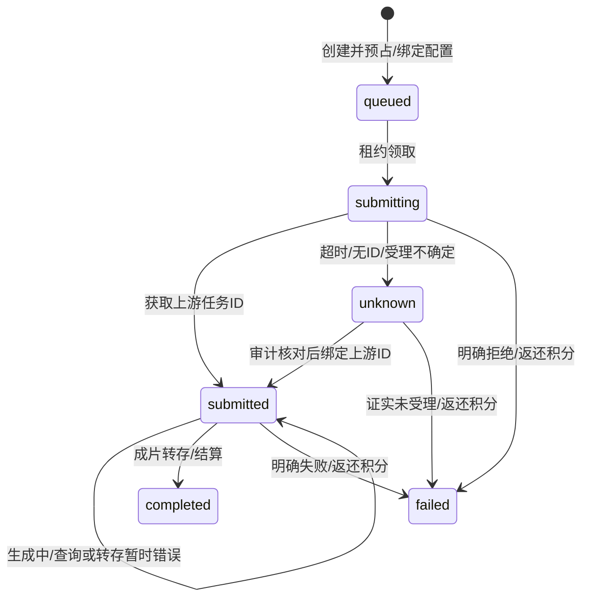

# 接口与数据契约

更新：2026-10-21，源码基线 `ce90bfe`。描述当前代码协议；当前官方云端仅有旧版本三个函数，见 [当前状态](CURRENT_STATE.md)。示例 UUID 为说明用途，接入时生成自己的 UUID。

## 1. 通用约定

业务 Edge API 基地址为 `${SUPABASE_URL}/functions/v1`。浏览器使用 SDK 登录后携带 `Authorization: Bearer <用户JWT>` 与项目公开 apikey；用户型接口拒绝 service_role 冒充用户。管理接口进一步检查 Auth 管理员身份。用户 CRUD 仍经 Supabase Data API，由 GRANT/RLS 限定本人数据。

JSON 请求使用 `Content-Type: application/json`，允许的预检由各函数处理。通常 400 表示参数/配置非法，401 未登录，403 无权限，402 视频积分不足，404 本人任务不存在，409 幂等/配置冲突，429 频控，503 运行错误或结果未确认。各接口具体状态以实现为准，不能把所有非 2xx 当作上游未受理。

## 2. 视频任务

入口 [video-jobs](../supabase/functions/video-jobs/index.ts)，仅 POST：

```json
{
  "action": "create",
  "request_key": "11111111-1111-4111-8111-111111111111",
  "provider": "ArkSeedance",
  "input": {
    "prompt": "商品置于桌面，缓慢推进镜头展示材质",
    "duration": 5,
    "resolution": "720p",
    "ratio": "9:16"
  }
}
```

`provider` 允许 ArkSeedance、MiniMax、SeedanceMini、Wan3、HappyHorse、Kling、Seedance。规格及首尾帧/参考视频的互斥与支持范围由 [video-providers](../supabase/functions/_shared/video-providers.ts) 校验，不承诺每个模型支持所有参数。

| Action | 参数 | 返回与语义 |
| --- | --- | --- |
| `create` | `request_key` UUID、`provider`、`input` | HTTP 202 `{job}`；数据库创建、预占与版本绑定；不证明已提交供应商 |
| `query` | `job_id` 或 `request_key` UUID | `{job}`；限定本人；可能领取到期任务执行一次，**不是只读健康检查** |
| `list` | 无额外参数 | `{jobs}`；本人有扣费关联的最近 30 条，创建时间倒序；未提供分页游标 |

公开 `job` 字段为 `id/project_id/provider/status/submission_state/billing_state/credit_cost/progress/video_url/error_message/needs_attention/created_at`。不回传上游 ID、密钥、扣费流水 ID、租约或配置密文。

创建 503 或响应丢失：复用相同 UUID 与参数查询/创建找回。相同 UUID 不同参数 409；禁用模型不影响找回已有任务。确定失败后再次生成是新任务。

## 3. 状态与执行器

三个状态维度分开解释：

| 维度 | 值与含义 |
| --- | --- |
| `status` | 服务端主链路使用 `pending/processing/completed/failed`；历史队列表也保留其他值，不能据此推断已支持取消 |
| `submission_state` | `queued` 待领、`submitting` 提交在途、`submitted` 有上游 ID、`unknown` 受理待核对 |
| `billing_state` | `reserved` 已预占、`settled` 成功结算、`refunded` 原流水积分返还 |



入口 [video-job-worker](../supabase/functions/video-job-worker/index.ts) 只接受 POST 和 `Bearer VIDEO_WORKER_SECRET`：

- `{"action":"probe"}`：只验证队列所需字段，返回 `{ready:true,version:1}`；不领取、不调用模型，也不保证配置可解密或供应商可用。
- `{"action":"run"}`：最多处理一个任务，返回 `{processed:0|1}`；省略 action 也按 run 处理。

租约默认 180 秒，`FOR UPDATE SKIP LOCKED` 避免并发重复领取。先持久化终态证据再执行状态/退款事务；退款事务失败后可由租约恢复重试。长期查询退避并标记 `needs_attention`，不会仅凭等待时长退款。

## 4. 模型设置

入口 [model-settings](../supabase/functions/model-settings/index.ts)，仅 POST：

| Action | 身份/输入 | 输出 |
| --- | --- | --- |
| `catalog` | 登录用户 | `{configs,admin}`；槽、名称、类别、启用、视频 provider |
| `list` | 管理员 | 设置、`version_id/has_key/updated_at`；无明文/密文 |
| `save` | 管理员；`slot/settings/enabled/version_id/api_key` | `{version_id}`；首次版本传 null，后续传当前 ID；并发冲突 409 |
| `import` | 管理员；历史服务端 Secrets | `{imported,skipped}`；只补尚未保存的有效槽 |
| `test` | 管理员；`slot` | `{ok,status,latency_ms,message}`；保存的只读 GET，10 秒超时 |

`settings` 字段为 `name/protocol/endpoint/query_endpoint/model/auth_header/auth_scheme/timeout_ms/voice/test_endpoint`。完整槽与协议见 [MODEL_SLOTS](../supabase/functions/_shared/model-catalog.ts) 和 [模型指南](MODEL_SETTINGS.md)。Key 留空保留原值；设置里显示的默认模型名称不证明该账号有权限。主密钥 AES-GCM 加解密，配置版本不可 UPDATE/DELETE，版本与槽绑定。

## 5. 同步生成与兼容入口

| 入口 | 核心输入/返回 | 应用计费与边界 |
| --- | --- | --- |
| `text-generation` | `messages`、`stream`、`temperature`、`max_tokens`；真实 SSE/JSON | 暂不扣应用积分，20 次/用户/分钟；最多 30 消息、单消息 16000 字符、输出最多 8192 tokens |
| `image-generation` | `prompt/size/quality/reference_image`；返回 `{image_url}` | 暂不扣应用积分，5 次/用户/分钟；真实图片转存，不提供视频式任务恢复 |
| `siliconflow-audio`、`stepaudio` | TTS 文本/音色，或 ASR 上传/Step 格式 | 暂不扣应用积分，10 次/用户/分钟；输入输出依协议 |
| `ai-assistant` | `action` 与业务参数 | 按 `credit_costs` Action 收费；缓存/限流拒绝不扣，失败按原流水补偿；部分 Action 仍有模拟业务逻辑 |
| 旧文本函数 | GLM/DeepSeek/Wenxin/MiniMax 兼容入口 | 复用统一主备配置；名称不代表固定供应商运行 |

图片处理器见 [image-provider](../supabase/functions/_shared/image-provider.ts)，音频见 [audio-handler](../supabase/functions/_shared/audio-handler.ts)。封面数据库/前端统一 `gen_task_id` 与 `completed`；不生成 CTR 预测值。网页 Reader 配置供商品卖点读取使用，没有独立公开任意抓取服务。

## 6. 数据与事务边界

| 数据 | 责任与关联 |
| --- | --- |
| `profiles/user_plans/plans` | 用户资料、套餐及 `credits_total/credits_used`；注册赠分默认 20 |
| `credit_costs/credit_logs` | Action 成本、扣费与补偿关联；视频默认 10；不存现金兑换承诺 |
| `orders/alipay_notify_events/alipay_refunds` | 订单渠道、金额、权益快照、支付宝通知/遗留退款记录；收款原子发放，现金退款另待验收 |
| `video_jobs/video_projects` | UUID 幂等、输入、原扣费、配置版本、租约、终态证据、作品结果 |
| `model_configs/model_config_versions` | 当前指针与不可变设置/密文版本；仅服务端管理 |
| `audit_logs/rate_limit_windows` | 配置和异常核对证据、频率控制 |
| Storage | `materials/videos/thumbnails`；成片固定 `generated-videos/{user_id}/{job_id}.mp4|webm`，当前公开桶 |

实际字段以 [迁移目录](../supabase/migrations) 为准。数据库关键接口包含 `create_video_job(...,p_config_version)`、`claim_video_job`、`checkpoint_video_job_result`、`record_video_job_event`、`save_model_config`、`bind_legacy_video_config`、`reconcile_video_submission`。普通用户不得直接执行这些状态/配置写入口；权限在 00028–00034 收敛。

`reconcile_video_submission(job_id,task_id,note)` 仅用于 unknown：真实上游 ID 恢复查询，`task_id=NULL` 表示已有**未受理证据**并释放积分。`bind_legacy_video_config(job_id,version,note)` 只证明核对了原配置，不改变未知受理事实；均为受控 service_role 操作并审计。

## 7. 支付与 MCP

支付接口、验签、权益快照与对账见 [支付方案](plan/支付.md)。支付宝查询是 GET `alipay-trade-query?order_no=...`，不能用 POST 或页面跳转直接认定支付成功。

MCP [接入指南](../mcp/mcp.md) 使用同一业务 API，HTTP 每次请求携带用户 JWT 并隔离并发身份；视频显式 UUID，默认 ArkSeedance。没有旁路计费或独立模型 Key。

API/字段变更必须同步调用端、迁移、测试、运维查询与 [追踪矩阵](CHANGE_TRACEABILITY.md)；删改旧签名前先核对未完成任务和当前已部署版本。
