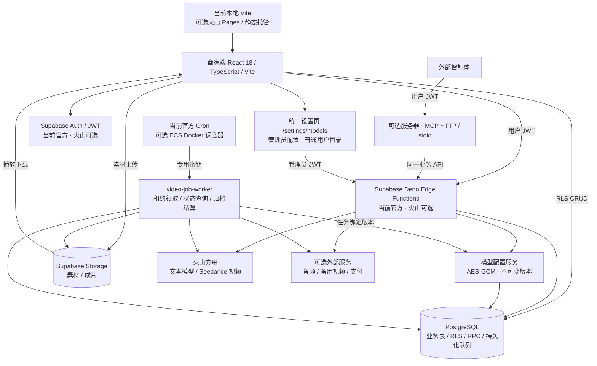

# Shopro AI 技术架构

更新时间：2026-10-21，源码基线 `ce90bfe`。当前实际运行在官方 Supabase，最新模型配置源码尚未全部部署；火山引擎 AI 原生 BaaS Supabase 版、Pages、ECS 是已适配的可选迁移方案。环境证据见 [当前状态](CURRENT_STATE.md)。

本轮新增本地私有素材、图片持久化任务、FFmpeg 渲染及抖音/TikTok发布和指标适配；启用与验证边界见 [生产链路迭代](ITERATION_06_PRODUCTION_PIPELINE.md)。这些源码新增项不表示现有云端已部署。

## 架构总览

系统仍依赖 Supabase SDK、Auth、PostgreSQL、Storage 与 Edge Functions。当前资源由 supabase.com 管理，实际 URL 为 `bbqqhkukgbgpebqpesub.supabase.co`；火山采用独立 workspace/branch 与管理 CLI，迁移验收后才切换。前端不要求 Vercel，可使用任意支持 SPA 的静态托管。

## 技术与部署映射

| 模块 | 技术 | 当前 / 可选部署位置 | 职责 |
|---|---|---|---|
| 商家应用 | React 18、TypeScript、Vite、React Router、React Query | 当前本地 Vite / 可选火山 Pages | 工作台、商品素材、作品、支付与数据页面 |
| UI | Tailwind CSS、Radix、Framer Motion、Recharts | 浏览器 | 表单、交互、图表 |
| 用户认证 | Supabase Auth / JWT | 当前官方 / 可选火山 BaaS | 邮箱登录注册、密码找回、配置后的短信 OTP |
| 业务 API | Deno TypeScript Edge Functions | 当前官方旧三函数 / 可选火山 BaaS | 文本、视频任务、AI 业务、支付回调；最新入口待发布 |
| 业务数据 | PostgreSQL、RLS、SQL RPC | 当前官方到 00031 / 可选火山 BaaS | 用户隔离、扣费、原子入账、幂等与审计 |
| 视频队列 | `video_jobs`、`lease_token`、`next_poll_at` | PostgreSQL | 持久化任务、到期领取与故障恢复 |
| 执行器 | `video-job-worker` | 当前官方 / 可选火山 BaaS | 有限时长提交/查询，不在函数中持续轮询 |
| 调度器 | 官方 Cron；Python 3.12 + Docker Compose | 当前官方 Cron / 可选常驻 ECS | 默认每 10 秒派发，最多 4 并发，退避和健康检查 |
| 成片存储 | Supabase Storage | 当前官方 / 可选火山 BaaS | 参考素材、MP4/WebM 成片固定路径 |
| 模型配置 | `model_configs`、`model_config_versions`、AES-GCM | 本地源码已实现；云端待 00034 | 全部模型接口统一管理、管理员授权、并发保护与任务版本绑定 |
| 模型 | 文本主备、七种视频、后台图片任务 | 方舟或设置页配置的供应商 | 真实已开通 Model ID / Endpoint ID，服务端协议适配 |
| 生产队列 | production_jobs / 租约 / 结案证据 | 本地已实现，云端待 00035–00036 | 图片恢复、剪辑、发布与原子归档/退款 |
| 剪辑 Worker | Python 3.12 / FFmpeg / Docker | 独立 ECS 或容器宿主机，待部署 | 时间轴合成、签名素材/上传、H.264/AAC |
| 平台与指标 | OAuth / 发布状态查询 / 数据快照 | TikTok、抖音正式 API，待账号联调 | 后台发布、审核、官方自然视频指标 |
| 音频 | OpenAI/Step TTS、ASR 协议 | 目标 Edge Function 代理外部服务，待发布 | 配置页统一模型、接口与音色 |
| MCP | Python FastMCP、Starlette、HTTPX | 可选 ECS 或本地 stdio | 7 个工具复用用户 JWT 与业务 API |
| 运维发布 | `byted-supabase-cli`、Python 部署脚本 | 开发机/受控发布环境 | SQL、Secrets、函数、Pages 与发布前预检 |

当前不需要 Redis：低至中等负载的任务队列使用 PostgreSQL `FOR UPDATE SKIP LOCKED`。执行器及用户查询共享租约。未来任务规模明显增长时再评估独立队列。

## 视频任务与积分

1. 浏览器将参考素材上传 Storage，使用 `request_key` UUID 创建任务。
2. 服务端校验用户 JWT、参数与模型配置；数据库同一事务检查配置启用状态、绑定配置版本、创建作品、扣费流水和队列任务。重复 UUID + 相同参数返回原任务，不重复扣费。
3. 调度器以 `VIDEO_WORKER_SECRET` 触发执行器；租约默认 180 秒，每次领取一个任务。
4. `ArkSeedance` 请求配置的方舟任务 API，随后按任务 ID 查询。提交与查询读取任务创建时的不可变配置版本，密钥只在服务端解密，更新账号不改变旧任务。
5. 成功视频先转存至 `materials/generated-videos/{user_id}/{job_id}.mp4|webm`，再持久化终态证据并原子更新作品与积分结算。
6. 确定拒绝或上游明确失败时，按原扣费流水退积分；暂时查询或存储错误继续重试。
7. 受理结果未知不重新 POST，也不按超时退款；运维核对后绑定上游 ID 或释放原扣费。

`reserved → settled / refunded` 是计费状态。预占通过已有积分扣减记录实现，没有独立冻结账户。当前单条视频价格仍从 `credit_costs.generate_video` 读取；迁移默认 10 积分，应在生产配置时结合实际模型成本设定。

## 文本、音频与 MCP

`text-generation` 使用平台认证、数据库每用户每分钟限流，返回真实 SSE/JSON。此提示词辅助端点目前不扣积分；原 `ai-assistant` 计费 Action 保留原逐笔扣费补偿逻辑。文本主备统一从设置页读取，旧 GLM/DeepSeek/Wenxin/MiniMax 函数只作为兼容入口，不再独立使用 Secrets。

`image-generation` 与封面共用持久化图片队列，以 request_key 创建、预占积分并归档到私有 Storage。图片返回后保存证据，归档重试复用原结果。封面统一 `gen_task_id`/`completed` 字段，不再伪造 CTR。音频合成、识别和商品 Reader 也读取同一配置服务。主加密密钥仅保存在 Edge Secrets，管理员凭据不回传；首次授权、旧配置导入与旧任务绑定见 [统一模型配置](MODEL_SETTINGS.md)。

前端删除模型 `VITE_*` 密钥、硬编码兜底密钥、代理回退与虚假文本/ASR 成功输出。构建拒绝非公开 `VITE_*KEY/SECRET/TOKEN/PASSWORD`。音频使用登录用户 JWT 调用 Edge Function。

MCP HTTP 使用请求中的用户 JWT，并通过 ContextVar 隔离并发调用身份；无状态 HTTP 避免会话复用混淆。视频工具要求显式幂等 UUID，复用 `video-jobs`；模型和 service_role 密钥不配置到 MCP。stdio 的用户 JWT 由受控环境提供。HTTP 服务需 TLS 反向代理及真实域名 allowlist。

## 数据与部署边界

- 普通商品、作品、脚本等 CRUD 仍通过 Supabase SDK 直连 Data API，授权由显式 GRANT 与 RLS 共同控制；关键财务与任务变更仅服务端 RPC 可执行。
- 现有云端仍需迁移才能启用私有桶。00035及匹配前后端提供用户隔离与限时签名，旧对象需核对真实归属。
- 调度默认使用 ECS Docker，不将火山支持 pg_cron、pg_net、Vault 作为上线前提。现有 Cron SQL 仅在目标环境确认这些扩展后可选使用。
- Pages 上传的是已构建 ZIP，URL/anon key 在构建前确定。Pages bind 建立 workspace 关联，不会改写 Vite ZIP 内已有常量。
- `config.toml` 不承担火山函数配置。生产函数清单在 `deploy/volcengine/manifest.json`，回调与 Worker 明确使用 `--no-verify-jwt`，函数内继续验签/验证专用密钥。
- 迁移排除 00018/00019 演示数据和演示访问策略；部署使用私有 `shopro_deploy.schema_migrations` 记录 SHA-256 回执，发现历史文件修改或无回执的旧业务库则停止重放。
- `backend/` 缺少运营后台核心源码，未纳入部署。FFmpeg剪辑、抖音/TikTok发布和指标回流已新增本地源码与回归，云端部署/账号验收待执行。其他平台、广告电商指标及部分编辑器演示工具仍未实现，批量生成不因迁移而变成已交付能力。
- 图片、网页 Reader、Kling 等必须在统一设置页配置兼容协议的 HTTPS 地址；运行时不回退旧网关环境变量。部分历史 AI 业务模拟逻辑保留且需要后续治理。
- 火山账号、BaaS 服务权限、方舟模型开通、SMTP/短信供应商、支付商户凭据和正式域名需目标环境配置。

当前官方记录见 [DEPLOYMENT_AIGCP](DEPLOYMENT_AIGCP.md)，可选迁移顺序见 [火山部署指南](VOLCENGINE_DEPLOYMENT.md)。接口/状态见 [API_AND_DATA](API_AND_DATA.md)，发布、监控与恢复见 [运维手册](RUNBOOK.md)，验证范围见 [测试报告](TEST_REPORT_20261021.md)。
