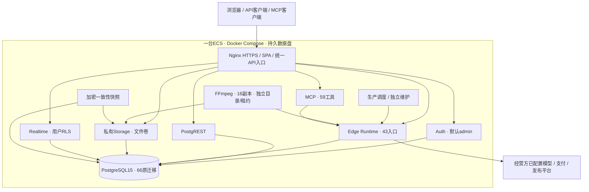
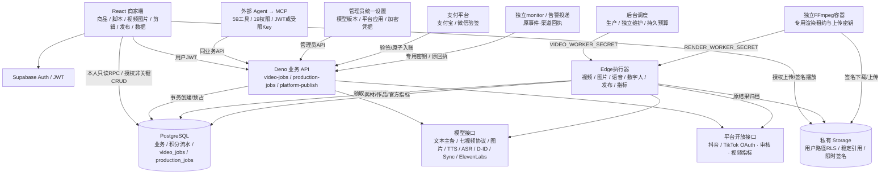

# 历史架构演进：生产基线之前

本文件是2026-10-31整理前的历史快照，包含不同迭代时点。当前权威架构为[技术架构](TECHNICAL_ARCHITECTURE.md)，不使用本文的旧部署/计数指导当前操作。

产品核心是视频生成，围绕创意输入、分镜、生成任务、媒体制作、导出与作品发布组织业务模块。商品资料与效果观测作为创作辅助模块。

更新：2026-10-31。当前应用已在火山ECS `https://ecs.example.com` 全部自托管运行，默认账号`[管理员账号]/[已脱敏]`。架构契约为00068/probe24/render4/edit2，66生产迁移、20模型槽、59个MCP工具/19权限、43个生产Edge入口。当前11类服务/26常驻容器，16个FFmpeg执行器；100个独立普通账号五分钟29044次业务请求、0错误、P95 17.52ms，100份10秒720p本地成片74.768秒排空，见[容量验收](../testing/SELF_HOSTED_CAPACITY_100_20261031.md)。原完整函数加载、真实权限/商品/MCP/FFmpeg成片、全组件重启、38公网页面和Realtime隔离见[自托管实施](../archive/before-v1.1.0/docs/architecture/SELF_HOSTED_ECS_IMPLEMENTATION.md)及[初次验收](../testing/SELF_HOSTED_ACCEPTANCE_20261031.md)，安装与恢复见[运行手册](../deployment/SELF_HOSTED_ECS_RUNBOOK.md)。目录/模块边界见[综合技术方案](../archive/before-v1.1.0/docs/architecture/PROJECT_ANALYSIS_AND_TECHNICAL_PLAN_20261030.md)和[ADR-001](decisions/ADR-001-modular-business-boundaries.md)。原官方云端记录独立保留；实际模型效果、收款和平台发布需经营凭据联调。

## 当前单机部署

账号、数据库、对象文件和实时消息均在ECS本地；自托管Supabase组件保留SDK与原业务协议。第一方访问使用统一HTTPS地址、专用CA及固定内部IP；供应商访问保持公网目的地校验。默认管理员 `[管理员账号]/[已脱敏]` 只在首次初始化创建，重复初始化保留改密、禁用和撤权。前端使用系统字体，不再阻塞于外部Google Fonts。

100人容量配置已部署到同一ECS，11类服务共26个常驻容器。PostgreSQL为8CPU/32GiB、240连接；Auth最大/空闲池均20、REST池48、Storage池32；Edge为8CPU/16GiB。16个FFmpeg副本各1.5CPU/4GiB，独立持久目录与锁，输入解码1线程、输出编码2线程、BLAS/OMP线程1；队列仍以数据库租约和fencing防止重复执行、扣费。常驻CPU预算合计51/64。Nginx使用2Worker/nofile8192、HTTP/1.1有界上游keepalive和16KiB REST响应头缓冲；普通Edge凭据每秒5请求/突发20，超量429，后台派发保持独立配额。配置和回滚见[运行手册](../deployment/SELF_HOSTED_ECS_RUNBOOK.md#100人容量配置)。

## 模块与目录边界

业务仍共享PostgreSQL事务和统一Edge入口，媒体/调度/维护/MCP/告警/备份独立运行。47页已按13业务域归组；底层不得依赖界面，共享组件/Hook/Context不得依赖页面；编辑共享类型位于src/types/editor.ts。七个现有跨运行时模块通过纯契约名单检查。归档不属于运行或发布指纹。

结构/循环/路径门禁为`pnpm check:structure`，已接入lint和CI。下一阶段先固化实际开发环境与全栈发布接受，再抽取首页生产向导及编辑领域组件；现有大页面仍有拆分工作，目录整理不视作全部架构重构完成。

## 本轮架构优化

- 前端使用账号级共享查询与完整持久回执；活跃、未知、终态、页面隐藏采用不同读取策略。编辑历史、工程恢复/串行保存、媒体时钟与缓存按业务状态拆分，首页录音/模型目录/素材恢复按原账号隔离。
- 同步文本/Reader每次调用先保存attempt，严格脚本结果与审核证据，主备共用总预算；数据库保存失败只恢复原结果和流水。模型现金成本依据供应商凭证登记，未知usage/金额保持未知。
- PostgreSQL保存20类加权进度和全局8/普通6/单类2额度，资金保留2机会。`run`仅执行已入队任务，`maintenance`独立领取计划/删除/留存/指标；`alive/ready/probe`分别核对入口、轻量就绪与完整能力。
- FFmpeg使用独占任务磁盘、可信对象下载去重、输入/输出/蒙版预算与停止恢复；HTTPS出口绑定核验的公网数字地址/证书/Host，不接受跳转或隐式代理。MCP限制正文、并发和时间预算。
- 凭据使用用途绑定v2密文和完整历史keyring。告警采用独立租约/原事件渠道幂等回执；认证归档上传/拉回后在空环境核对原UUID/UNKNOWN/历史密钥/实物。
- 冻结依赖、四套镜像源码与前端发布身份共同形成全栈回执；真实迁移摘要、Auth/Storage/Edge只读接受与实际运行证据分开。知识检索预存范数保留精确过滤/排序，商品采用稳定时间/UUID游标。

运行细节见[调度](../operations/WORKER_SCHEDULING.md)、[资源](../operations/MEDIA_WORKER_RESOURCES.md)、[密钥](../operations/KEY_ROTATION.md)、[告警](../operations/ALERT_DELIVERY.md)、[容量](../operations/DATABASE_CAPACITY.md)。

## 历史演进摘要

以下段落保留每轮设计、数量及当时待部署状态；它们属于历史迭代。当前运行版本与实际ECS验收以本页顶部及单机验收为准。

最新 [迭代34](../archive/iterations/ITERATION_34_IMAGE_EDITING.md)：图片模式与协议能力共用契约，模型不可变版本增加可选编辑地址；原图/透明掩码先私有登记与有界解码，00062事务确认价格和配置后复用原任务/流水。checkpoint归档恢复不依赖源读取或再调用；任务请求固定JWT、核对发起账号和迟到代次，15秒后原回执恢复。工具入口统计来自实际目录。probe22/00062/render4/edit2，下文为历史演进。

上一轮 [迭代33](../archive/iterations/ITERATION_33_CREDITS_SMS.md)：本人余额/权益单次只读快照、账号QueryClient共享与取消、单份Realtime/可见页轮询；服务端时钟与单调经过时长控制在页到期。去模块全局余额与无调用浏览器资金入口，生成前权威回源；SMS隔离SDK/15秒/离页取消/原手机回执后全局登录，通知固定原账号。

当前 [迭代31](../archive/iterations/ITERATION_31_ACCOUNT_STORYBOARD.md)：账号作为布局与React Query缓存边界，切换后清除继承的路由输入；Auth资料请求按身份/代次核对，SDK回调延后读取。本人概览在数据库完整聚合并用owner/created索引计算时区日期，头像加入生命周期引用。首页分镜复用Script/Works/Batch组件，原UUID保存恢复与真实SSE解析替代重复实现及模拟阶段；00059/probe19/render4/edit2。

前一轮 [迭代30](../archive/iterations/ITERATION_30_WORKS_LIBRARY.md)将作品库与首页统一到原素材登记协议；首页作品列表限40条且提供全库入口，随机统计和公开模拟互动移除。

当前 [迭代29](../archive/iterations/ITERATION_29_ALERTS_RECOVERY.md)统一直接扣费和创建入口的套餐→团队/风险→团队行锁，真实PG死锁先复现再修复。告警使用service-only原对象规则/版本/事件，按现有财务/运营客户范围授权，原UUID接手、真实恢复与再次发生保留同一记录；后台monitor独立于任务执行，数据库不可达用持久卷保存故障。备份使用数据库导出快照与Storage映射复核，分块AES-GCM归档DB/实物/回执/扩展与历史密钥，空隔离库单事务恢复、内容摘要/文件hash/历史解密验证。00058/probe18/render4/edit2匹配全栈待目标验收，外部通知/异地保管与生产容量未验证。

最新 [迭代28](../archive/iterations/ITERATION_28_OPERATIONS_WORKFLOWS.md)将工单/租户/风险/现金成本收敛到现有service-only事务与原UUID回执，不另建模拟后台。工单版本约束回复与分配、内部消息按身份过滤；团队行锁串行成员/所有权/预算，原charge_id记录创建时归因；风险只阻止新计费、原任务恢复与退款保持独立。现金账本绑定原调用/配置版本，分币种整数、指纹、账单行唯一与追加冲销；前端共用流程表单/详情，00056/probe17/render4/edit2及匹配全栈待发布，MCP仍59/19权限。

最新 [迭代27](../archive/iterations/ITERATION_27_BATCH_PIPELINE.md)新增持久阶段图：创建事务固定全部原UUID/商品/版本/预算，待依赖阶段保留原扣费流水但不占执行槽；服务端推进依赖并复用现有视频、媒体、字幕和FFmpeg任务。父批次锁约束领取、暂停和取消，未知受理继承原证据恢复；真实配音长度由FFmpeg测量。最终私有工程、真实字幕及多账号发布组在原阶段串联，公开发布等待实际预览确认。00055/probe16/render4/edit2、MCP59/19权限待匹配全栈发布；大规模吞吐与真实目标仍需实测。

最新 [迭代26](../archive/iterations/ITERATION_26_EDITOR_ASSETS.md)把资源、上传、录音、音频编辑和时间轴媒体预览拆成独立组件；素材与原请求回执在service-only事务中核对本人Storage证据，删除墓碑阻止复活。缓存按页面/账号有界128MB并合并重复请求；render4对音频EQ/回声/机器人分别校验，MCP58复用render:create。00054/probe15/render4/edit1全栈待发布；自动编排、规模与目标设备仍继续验收。

最新 [迭代25](../archive/iterations/ITERATION_25_EDIT_ANALYSIS.md)将音轨裁剪/变速/节拍与ASR模型拆成有租约、原文件hash和checkpoint的两个后台阶段，复用原价格/账户锁/退款与任务中心。人物分割固定模型/摘要/许可证，逐帧FFV1/BGRA蒙版与原音轨分别进入FFmpeg；运行期不下载模型，空间/时限和实际成片时长有界。00053/probe14/render3/edit1与匹配全栈待发布，长素材CPU/质量及真实Whisper待验收。

最新 [迭代24](../archive/iterations/ITERATION_24_WECHAT_TRANSACTIONS.md)以服务端wechat_transactions保存原商户/支付期限/独立租约及查单退避，替换未固定版本的微信插件为WebCrypto官方v3签名/原文验签/AES。两渠道共用cash-trade-ops权限与原申请、账户→订单→退款锁和内部权益事务；调度只核对原现金退款。00052/probe13/render2与匹配全栈待发布，真实支付、规模化对账及备份恢复仍待验收。

最新 [迭代23](../archive/iterations/ITERATION_23_DATA_LIFECYCLE.md)以数据库触发器统一媒体引用索引和对象级事务锁，避免清理时全表扫描及保存/TTL竞争；心跳不重写未变引用。媒体/声纹删除outbox独立UUID租约、原配置版本和回执，知识删除清理副本并过滤晚到结果，终态证据有界七天清理。复用现有队列/账户锁/原退款，MCP56/18权限，probe12/00051/render2；容量、真实供应商及备份恢复仍待验收。

最新 [迭代21](../archive/iterations/ITERATION_21_TRANSLATION_NOTIFICATIONS.md)复用production_jobs/账户锁/配置版本/原结果证据，将商品翻译加入共享4槽；商品快照/图片SHA-256与模型版本绑定，原结果核对共用SQL校验。竞品引用由事务读取正式快照并独立留存；通知在真实状态事务内触发且去重，RLS/RPC和用户维度React Query共享列表/铃铛，批量cutoff保护新消息。00049、MCP54/18权限、probe v10/render2；匹配全栈与供应商待验收。

最新 [迭代20](../archive/iterations/ITERATION_20_CASH_OPERATIONS.md)在现有React/Supabase新增真实运营入口，避免复建Vue/Mock中台；可信权限/客户范围与资金/预算回执在DB执行。现金退款统一账户→订单→退款锁、金额预占/原UUID/签名证据、到账/权益/审计原子化；支付发放同锁顺序且保留欠额。UTC日预算统一在deduct_credits执行，队列复用只查询退款，probe v9/00048。完整租户/工单/风险处置/现金成本与实际部署仍待交付。

最新 [商品管理迭代19](../archive/iterations/ITERATION_19_PRODUCT_MANAGEMENT.md)统一两处导入/表单/字段校验/API，撤销浏览器商品写权限。后台product_import复用租约队列，以真实来源/图片/证据归档；商品写入/版本/来源一次性/回执/审计同事务。CSV与页面不再重复解析/猜测结果。00046、MCP52/18权限，常驻调度严格匹配probe v8/00046；目标云端部署仍待验收。

00045 [发布组](../archive/iterations/ITERATION_18_PUBLISH_GROUPS.md)复用原production_jobs：用户→作品锁、源/时长快照、整组事务与每账号独立Worker证据；单账号与组共用24配额，unknown保持占用。发布契约在页面/API/Worker共用，47工具沿原业务权限；probe v7要求00045。后端/迁移/MCP/前端须匹配部署，真实平台仍待验收。

新增 [MCP迭代17](../archive/iterations/ITERATION_17_MCP_PRODUCTION.md)：45工具复用统一业务API，16权限共用签发/路由/页面目录；JWT/Key按请求ContextVar隔离，媒体显式价格/原UUID、业务POST不自动重试，固定八入口/2MB/禁止重定向。platform-accounts仅安全读取接受Key，OAuth/应用管理仍JWT；无新增schema，匹配函数和MCP镜像必须同步发布。

新增 [渲染效果迭代16](../archive/iterations/ITERATION_16_RENDER_EFFECTS.md)：效果目录共用于前端与API，Worker固定RGB/alpha公式与参数二次校验；时间排序的主轨转场保留工程长度，蒙版混合保留定位与透明度。仍复用production_jobs/专用签名/租约，不新建执行旁路；版本1新增可选参数需匹配API与重建镜像同步发布。HSL逐像素成本需真实4K压测。

00044 [市场情报](../archive/iterations/ITERATION_15_MARKET_INTELLIGENCE.md)复用业务API/生产队列/积分事务，新增20槽中的三个版本数据源、官方YouTube/eBay适配和授权网关校验。两页共用来源与计划组件，预算由数据库锁/独立回执约束，checkpoint避免重复采集，30天清理所有来源副本。最新探针v6、发布00032–00044；仍需真实供应商/平台权限与云端验收，以下较早版本范围为历史。

00043 [知识检索](../archive/iterations/ITERATION_14_KNOWLEDGE_RETRIEVAL.md)沿现有统一API/生产队列新增knowledge_index/search，独立Embedding配置与不可变版本、原账户积分、checkpoint、私有knowledge_chunks及余弦检索。正文SHA-256失效、用户与版本隔离、服务端验证引用；配置槽由数据库目录统一校验，减少复制名单。当前200条/24块有界精确扫描，pgvector/大规模吞吐另需容量评估；不是模型训练。探针v5，待部署范围00032–00043。

00042新增 [观测及实验边界](../archive/iterations/ITERATION_13_MEASUREMENTS_EXPERIMENTS.md)：独立签名采集入口→来源行锁/正文回执→日数据版本替换或持久分组/去重事件→统一报告及统计；自然视频累计指标不进入广告漏斗或随机样本。来源管理员登记/AES-GCM/停用，报告JWT/metrics:read，所有新表仅业务RPC访问。服务端全量汇总、明细上限和索引，预注册主指标/样本/固定窗口后双尾及Holm/Wilson，利润ROI及未经观测指标缺失。需00032–00042和匹配函数，探针v4；供应商与云端未验收。

00041新增 [两段素材分析](../archive/iterations/ITERATION_12_GROUNDED_ANALYSIS.md)：FFmpeg租约读取私有视频→真实元数据/8帧/16kHz音轨/源指纹→prepared事务释放→生产Worker按旧ASR与文本版本分析→检查字幕引用→结果/风格历史原子结案。视频高光交给既有render任务输出MP4；模型编辑评分与经营实测分开。

原官方Supabase保留旧00031/三函数及管理401的历史记录。当前ECS是独立新实例，已初始化66原迁移和43完整函数；没有导入或覆盖原官方账号、业务账和对象文件。环境证据见[当前状态](../CURRENT_STATE.md)。

本轮新增本地私有素材、图片持久化任务、FFmpeg 渲染及抖音/TikTok发布和指标适配；启用与验证边界见 [生产链路迭代](../archive/iterations/ITERATION_06_PRODUCTION_PIPELINE.md)。这些源码新增项不表示现有云端已部署。[原版功能覆盖校验](../archive/reviews/FUNCTION_COVERAGE_REVIEW_20261021.md)确认页面全部保留，但原版全部功能范围尚未覆盖。

服务端Key摘要/权限/限流、团队成员事务与共享ACL、私有形象、对象outbox已实现；00056/57扩展团队UTC预算并统一锁序。费用仍归提交者，企业共同付款和协同工程未交付；已有签名在到期前仍有效。

[批量视频迭代](../archive/iterations/ITERATION_09_BATCH_VIDEO.md) 新增00038与batch-video-jobs，整批商品事实快照/预算/套餐/版本在同一事务创建，复用原video_jobs和Worker。领取未提交子任务先共享锁父批次，暂停/取消排他锁阻止竞态提交；已受理结果继续查询，取消仅按原流水释放未提交项。批次终态/资金由子任务实时汇总，不新增独立模型执行器。

新增 [多规格导出](../archive/iterations/ITERATION_10_RENDER_EXPORTS.md)：00039的render_exports把全部输出作品/production_jobs放在一个事务，每人24个未结案渲染共用账户锁和配额，最多18种六画幅/三分辨率组合。受理恢复先查询原请求，源删除不重建任务，独立成片归档沿既有Worker。模型目录独立维护退役记录，官方Sora API于2026-09-24关闭，不加入可启用槽。

新增 [后台语音与数字人](../archive/iterations/ITERATION_11_AUDIO_AVATAR_JOBS.md)：00040扩展production_jobs的tts/asr/voice_clone/avatar/lipsync，复用账户锁、配置版本、证据与原流水退款。16槽包括D-ID/Sync/ElevenLabs，原声纹配音绑定克隆账号历史版本；每用户10个未结案媒体任务，共用生产调度轮转领取。网页提交前确认实际价格，失联恢复原UUID，照片口播工程原子创建，专业训练/全身动作仍未实现，云端未更新。

## 架构总览

系统保留 Supabase SDK、Auth、PostgreSQL、Storage 与 Edge 协议，当前交付由单机Compose自托管这些组件。原官方Supabase环境及火山BaaS发布工具属于独立历史/可选环境；安装新实例不会接管、清空或重放原云端数据库。

## 技术与部署映射

版本依据：2026-10-31重新读取ECS运行镜像及程序版本；前端版本按项目依赖主版本列出，完整解析版本以pnpm-lock.yaml为准。平台镜像均固定SHA256摘要。ECS实测Nginx1.31.7、渲染器Python3.12.15、FFmpeg7.1.5；Docker29.1.3、Compose2.40.3。

| 模块 | 技术组件 | 当前部署位置 | 职责 |
|---|---|---|---|
| 商家应用 | React18、TypeScript5、Vite5、React Router6、TanStack Query5、Supabase JS2.103.1 | ECS Nginx静态前端；浏览器执行 | 工作台、商品素材、作品、支付与数据页面 |
| UI | Tailwind CSS3、shadcn/ui/Radix、Framer Motion12、Recharts2、React Hook Form7 | 浏览器 | 组件、表单、交互、动效与图表 |
| HTTPS网关 | Nginx1.31.7、TLS1.2/1.3 | ECS proxy容器 | 静态前端、Auth/REST/Storage/Edge/Realtime/MCP统一入口 |
| 用户认证 | GoTrue2.197.0、JWT/HS256 | ECS auth容器 | 默认管理员、邮箱登录、可信角色；SMTP/SMS需配置 |
| REST接口 | PostgREST14.18 | ECS rest容器 | 将PostgreSQL表/视图/RPC映射为REST，执行GRANT/RLS |
| 业务 API | Supabase Edge Runtime1.77.4、Deno/TypeScript | ECS functions容器，冻结43入口 | 文本、视频任务、AI业务、支付回调与业务授权 |
| 业务数据 | PostgreSQL15、RLS、SQL RPC | ECS数据库卷 / 66原迁移 | 用户隔离、扣费、原子入账、幂等与审计 |
| 实时消息 | Supabase Realtime2.143.3、WebSocket、PostgreSQL变更订阅 | ECS realtime容器 | 本人作品、积分及素材等订阅，用户隔离 |
| 视频队列 | PostgreSQL行锁/SKIP LOCKED、video_jobs、lease_token、next_poll_at | ECS PostgreSQL | 持久化任务、到期领取与故障恢复 |
| 执行器 | `production-worker` | ECS Edge Runtime | 有限时长提交/查询，不在函数中持续轮询 |
| 调度器 | Python3.12、持久预算/租约、Docker Compose | ECS scheduler/maintenance两个独立容器 | 默认每10秒派发、额度、退避、维护与健康检查 |
| 成片存储 | Supabase Storage API1.81.0、本地文件后端、签名URL | ECS storage容器与文件卷 | 私有素材、成片稳定引用与限时签名 |
| 模型配置 | `model_configs`、`model_config_versions`、AES-GCM | ECS数据库/模型设置 | 20槽、管理员授权、并发保护与任务版本绑定 |
| 模型 | 文本主备、七种视频、后台图片任务 | 方舟或设置页配置的供应商 | 真实已开通 Model ID / Endpoint ID，服务端协议适配 |
| 生产队列 | production_jobs / 租约 / checkpoint / 持久预算 | ECS00068，probe24 | 图片编辑、媒体、分析/字幕、知识、情报、翻译、编排/发布 |
| 剪辑 Worker | Python3.12.15、FFmpeg7.1.5、OpenCV4.11、NumPy2.2.6、固定ONNX人物分割模型 | ECS renderer 16个独立容器 | 持久队列并行执行、时间轴合成、抽帧、音频/字幕、人物蒙版、H.264/AAC |
| 知识检索 | PostgreSQL向量数组、余弦相似度、后台Embedding任务 | ECS数据库/Edge；Embedding供应商需配置 | 按用户/内容版本保存分块与向量，权限过滤后精确检索 |
| 平台与指标 | OAuth / 发布状态查询 / 数据快照 | TikTok、抖音正式 API，待账号联调 | 后台发布、审核、官方自然视频指标 |
| 音频/数字人 | OpenAI/Step、ElevenLabs IVC、D-ID Talks、Sync协议适配 | ECS任务与接口已部署；供应商需配置 | 配音/识别/声纹/口播/口型队列、私有归档及积分闭环 |
| MCP | Python3.12、MCP SDK1.30.0内置FastMCP、Starlette1.10.0、HTTPX0.28.1、Uvicorn0.54.0 | ECS mcp容器/统一HTTPS入口；可选stdio | 59工具/19权限、原请求与预算、请求ContextVar隔离 |
| 账号与权益 | AccountScope、独立QueryClient、本人RPC | ECS接口/数据库＋浏览器 | 当前账号/代次、共享余额、单份订阅、SMS独立验证会话 |
| 运营/财务 | operations、可信授权/范围、原UUID回执 | ECS接口/数据库 | 工单/租户/预算/风险、现金退款与分币种供应商账本；真实商户需配置 |
| 告警/备份 | 独立monitor/投递租约、持久卷、AES-GCM认证归档、SHA256 | ECS维护组件/备份工具；异地目的地需配置 | 原告警回执、DB/实物/历史密钥、停机一致性快照与新卷恢复 |
| 运维发布 | Ubuntu24.04、Docker29.1.3、Compose2.40.3、Python自托管CLI、固定镜像摘要 | 同一ECS / 受控构建环境 | 11类服务/26常驻容器、离线安装、初始化接受、加密快照及隔离恢复 |
| 开发与验证 | Node22.23.4、pnpm10.34.5、TypeScript、Biome2.4.5、Playwright1.60、Python unittest | 开发/CI/隔离验收环境 | 锁定依赖、lint/类型检查、业务回归、真实浏览器验证 |

当前不需要 Redis：任务队列使用 PostgreSQL `FOR UPDATE SKIP LOCKED`。旧视频查询可触发一次受控处理，图片/发布依赖新生产调度，FFmpeg依赖独立容器；不能只升级旧视频Cron。上述为源码逻辑架构，实际吞吐/并发容量需部署后测量。

## 当前业务全景与覆盖边界

商品/私有素材、脚本/12语言翻译、七视频、图片编辑、五媒体、真实FFmpeg成片、多规格导出/发布组、知识检索、官方情报/签名观测均有本地执行链。00055多镜头阶段图固定商品/镜头/确认台词/音色/版本/预算，依次测量音轨、可选字幕和合成工程，发布等待真实预览和逐账号授权；不存在无人审核自动投放承诺。

支撑层包括原子注册/验证奖励、权威权益、账号请求隔离、Key/团队共享、个人团队UTC预算、可信运营/工单/风险、两渠道退款、人工供应商现金、真实通知、生命周期及加密恢复。企业统一付款账套、自动发票、商业资源交易、更多平台、全身训练/自由画笔/自动学习仍有缺口；Sora为退役供应商。覆盖以 [综合基线](../archive/reviews/RELEASE_BASELINE_20261022.md)为准。

## 账号、运营与恢复的数据边界

账号切换重建布局和QueryClient并清除继承路由输入；本人概览/积分无user_id参数。Auth资料与敏感写按原身份/代次核对，SMS独立SDK验证原手机后才安装全局会话。JWT仅留请求内存，原UUID/输入用于断线恢复。服务端时钟与单调经过时长判定在页套餐到期，读取故障不伪降级。

新计费在套餐→用户团队锁→用户风险锁→团队行的统一顺序校验个人/团队预算及限制；原charge固定创建时归因。工单与租户/风险变更检查原版本/当前客户范围，内部消息过滤。现金退款按账户→订单→退款顺序、预占/签名到账/权益回收同事务；供应商成本最小货币单位、账单行唯一、追加冲销，不按积分推算现金。

生命周期触发器维护对象引用索引/对象锁，原登记回执与删除墓碑阻止复活，unknown证据不TTL清除。独立monitor按原规则/对象去重、恢复/再发生，数据库不可达写持久卷。备份导出一致DB快照并冻结Storage变化，AES-GCM认证DB/实物/扩展/回执/历史密钥；空隔离恢复核对内容摘要/对象hash，保持unknown，不启动供应商。

## 视频任务与积分

1. 浏览器将参考素材上传 Storage，使用 `request_key` UUID 创建任务。
2. 服务端校验用户 JWT、参数与模型配置；数据库同一事务检查配置启用状态、绑定配置版本、创建作品、扣费流水和队列任务。重复 UUID + 相同参数返回原任务，不重复扣费。
3. 调度器以 `VIDEO_WORKER_SECRET` 触发执行器；租约默认 180 秒，每次领取一个任务。
4. `ArkSeedance` 请求配置的方舟任务 API，随后按任务 ID 查询。提交与查询读取任务创建时的不可变配置版本，密钥只在服务端解密，更新账号不改变旧任务。
5. 成功视频先转存至 `materials/generated-videos/{user_id}/{job_id}.mp4|webm`，再持久化终态证据并原子更新作品与积分结算。
6. 确定拒绝或上游明确失败时，按原扣费流水退积分；暂时查询或存储错误继续重试。
7. 受理结果未知不重新 POST，也不按超时退款；运维核对后绑定上游 ID 或释放原扣费。

`reserved → settled / refunded` 是计费状态。预占通过已有积分扣减记录实现，没有独立冻结账户。当前单条视频价格仍从 `credit_costs.generate_video` 读取；迁移默认 10 积分，应在生产配置时结合实际模型成本设定。

## 文本、音频与 MCP

`text-generation` 使用平台认证和持久限流，依赖故障拒绝，返回真实SSE/JSON。提示词辅助端点保留不扣应用积分的行为，每次真实供应商尝试仍登记原配置/usage。`ai-assistant`付费脚本使用00063原请求/结果/流水事务；文本主备统一设置与总预算，旧独立模型函数仅兼容入口。

`image-generation` 与封面共用持久化图片队列，以 request_key 创建、预占积分并归档到私有 Storage。图片返回后保存证据，归档重试复用原结果。封面统一 `gen_task_id`/`completed` 字段，不再伪造 CTR。音频合成、识别和商品 Reader 也读取同一配置服务。主加密密钥仅保存在 Edge Secrets，管理员凭据不回传；首次授权、旧配置导入与旧任务绑定见 [统一模型配置](../development/MODEL_SETTINGS.md)。

前端删除模型 `VITE_*` 密钥、硬编码兜底密钥、代理回退与虚假文本/ASR 成功输出。构建拒绝非公开 `VITE_*KEY/SECRET/TOKEN/PASSWORD`。音频/数字人通过production-jobs使用JWT或限定scope Key，旧同步音频入口410，浏览器朗读不再冒充生成结果。

MCP HTTP使用每请求JWT/受限Key和ContextVar隔离。59工具/19权限、显式UUID与收费确认保持；原默认每进程16活跃，当前100人配置为128活跃/同凭据4并发、256KiB正文/10秒读取/165秒工具预算，业务响应2MB上限、固定九入口且不跳转。断线不重发POST，原键恢复；模型/service_role不配置到MCP。ECS统一HTTPS入口已通过真实100账号并发握手、工具清单和后端调用；当前IP证书为自签CA，正式域名证书需另外配置。

## 数据与部署边界

- 商品写入、素材登记/删除、团队/密钥/运营、知识删除、奖励、资金与任务状态使用受限API/RPC；本人读取及允许的工程/脚本CRUD经GRANT/RLS。不能沿用旧商品/奖励直写。
- 当前ECS私有桶/RLS与限时签名已通过；若接管原官方云端的旧对象，需要另外核对归属和迁移，不能直接公开原桶。
- 调度默认使用 ECS Docker，不将火山支持 pg_cron、pg_net、Vault 作为上线前提。现有 Cron SQL 仅在目标环境确认这些扩展后可选使用。
- 当前ECS前端通过公开runtime-config.js绑定本实例API/anon；历史Pages ZIP在构建前确定URL/anon，Pages bind不修改ZIP常量。
- 当前43个Edge入口来自`infra/volcengine/manifest.json`并冻结为离线bundle，由自托管Edge Runtime加载；函数内继续验签及验证专用Worker密钥。官方/火山托管发布工具使用各自配置与回执。
- 迁移排除 00018/00019 演示数据和演示访问策略；部署使用私有 `shopro_deploy.schema_migrations` 记录 SHA-256 回执，发现历史文件修改或无回执的旧业务库则停止重放。
- `archive/legacy-backend/`为历史规格，当前运营入口使用React/Supabase真实事务；43入口不含setup-demo，包含兼容/410接口，数量不代表43项可售能力。全部匹配00068/probe24/render4/edit2、前端身份与镜像后再做真实接受。
- 图片、网页 Reader、Kling 等必须在统一设置页配置兼容协议的 HTTPS 地址；运行时不回退旧网关环境变量。部分历史 AI 业务模拟逻辑保留且需要后续治理。
- 单机运行不依赖BaaS管理权限；真实模型、SMTP/短信、商户、平台授权和正式域名证书需经营方配置。

当前ECS运行与恢复见[单机手册](../deployment/SELF_HOSTED_ECS_RUNBOOK.md)，最新验证见[单机验收](../testing/SELF_HOSTED_ACCEPTANCE_20261031.md)。原官方历史记录见[DEPLOYMENT_AIGCP](../releases/DEPLOYMENT_AIGCP.md)，可选托管迁移见[火山部署指南](../releases/VOLCENGINE_DEPLOYMENT.md)，接口/状态见[API_AND_DATA](../development/API_AND_DATA.md)。
