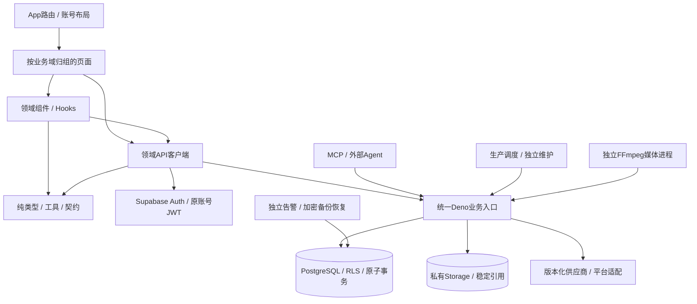

# 项目分析、目录优化与技术方案

日期：2026-10-30。分析起点：`63ff09910869990a84f7cb4e626c602a0737e63e`。

本轮完成目录整理、路径修复、依赖门禁和技术方案更新。其余架构演进按下列阶段实施。本文依据当前检出、实际调用关系和本轮验证；2026-10-25方案与2026-10-27实施记录作为历史证据分别保留，不再将已完成的可靠性改造列作待开发。

## 1. 核心判断

项目已形成 React + Supabase + 独立媒体 Worker 的业务闭环。现阶段应沿现有事务和任务协议做模块化治理，优先解决环境与发布一致性、页面耦合及维护成本。直接改成微服务或另建运营后台会扩大数据一致性和迁移成本。

最紧急的问题是环境可复现性和目标部署差距。前端容器仍将后端地址覆写为 `http://127.0.0.1:54321`；本轮访问该地址的 Auth health 立即连接失败。2026-10-29管理员创建/登录成功属于当时事实，不能据此认定当前登录服务仍可达。官方云端最新完整历史证据仍为00031与三个旧函数，本轮未重新检查云端，当前源码00068的模型配置、任务、运营等能力不能只靠发布前端启用。

目录混杂已在本轮处理：47页按13个业务域归组；历史后台、独立旧API、实验、技能工具和研究材料有了明确位置。802份原受控普通文件全部保留，68份SQL迁移摘要不变；独立Git链接 `clipforge` 保留原位置。目录调整不改变数据库版本或业务路由。

## 2. 仓库与工程现状

| 观察 | 当前事实 | 技术含义 |
| --- | --- | --- |
| 仓库边界 | AIGCP内的 `shoproai` 是独立Git仓库，基线803条受控路径，其中1条gitlink | 安装、发布、检查均以项目根目录为边界 |
| 前端 | React18、TypeScript、Vite5、React Router6、React Query5；47页 | 已有路由懒加载和账号级查询边界，继续保持 |
| 服务端 | Deno2.2.6、44源码入口、43生产manifest入口、共享模块 | 兼容/410入口也计入数量，不等于43项可售能力 |
| 数据 | 68迁移文件，生产排除演示18/19；最新00068 | 历史迁移不能重写，目标升级必须核对原摘要/回执 |
| 任务 | video_jobs / production_jobs、原UUID、租约、checkpoint、不可变配置 | 已有持久任务协议，不另建浏览器执行或第二套消息状态 |
| 调度 | 持久公平预算、全局8/普通6/单类2、独立maintenance、probe24 | 分配机会不是吞吐SLA，需要实际负载测量 |
| 媒体 | Python3.12、FFmpeg、私有Storage、资源预算/缓存/退出恢复 | 与Edge保持独立部署，重任务不能放回浏览器或长轮询函数 |
| 模型 | 20槽、真实协议适配、尝试/usage/现金登记及32例评估材料 | API可达、输出质量、人工事实核对、账单成本分别验收 |
| MCP | FastMCP、59工具/19权限、同业务API、身份与请求预算 | 继续复用统一API，不增加资金或模型执行旁路 |
| 发布 | pnpm/Deno/Python冻结依赖、四镜像、全栈源码身份和只读接受 | 已有基础设施；此次补足目录/配置指纹与归档边界 |
| 工程规模 | 整理前src212、Supabase174、tests138、docs82条受控路径 | 当前主要复杂度在业务状态和协议，不在服务数量 |
| 历史材料 | backend缺src运行入口；api与scratch无当前运行调用 | 归档保留追溯，但不宣称它们是可启动的生产服务 |
| 临时产物 | 原根目录459份log；`.volcengine-build`约3.1GB | 日志归集到忽略目录，诊断产物不作为源码或Docker上下文 |

最长前端模块仍为剪辑器4906行、首页2100行、数字人1160行、脚本1039行。剪辑器本轮仅提取共享类型，后续拆分应按副作用/状态职责推进，不能用目录层级掩盖单文件复杂度。

## 3. 本轮已落地

| 改动 | 原问题 | 实施结果 |
| --- | --- | --- |
| 页面归组 | 47页平铺，查找职责困难 | `src/pages/{auth,marketing,workspace,catalog,production,intelligence,analytics,knowledge,account,billing,operations,settings,system}` |
| 文档归组 | 当前手册、迭代、旧研究混在同层 | architecture/development/testing/operations/releases/archive；保留文档中心、CURRENT_STATE、PENDING_CHANGES、CHANGE_TRACEABILITY入口 |
| 旧代码与工具 | backend/api/scratch/skill-creator占据运行根目录 | archive保留旧代码与实验；tools保留技能工具/文档生成器及许可证 |
| 路径修复 | App、跨页/跨运行时import、模型UI夹具和bundle测量引用旧位置 | 调用方全部同步，URL不变，保留直接动态import |
| 依赖方向 | 音频面板和预览组件import页面定义的TrackItem | 共同依赖 `src/types/editor.ts`，共享层零反向页面依赖 |
| 开发配置 | Vite开发入口引用不存在的vite.config；Node/shadcn配置目标过期 | 显式引用vite.config.mjs、Node include更新、Tailwind指向实际js |
| 持续检查 | 没有目录/层间依赖/本地链接门禁 | `pnpm check:structure`检查实际AST依赖、循环、跨运行时纯契约、目录与链接；接入lint/CI |
| 发布身份 | 旧独立api仍被计入运行指纹，部分前端配置缺失 | 归档不进release manifest；开发/TS/Tailwind/PostCSS配置纳入指纹 |
| 构建上下文 | 历史代码/实验/工具可能混入Docker上下文 | `.dockerignore`排除archive/tools/docs/archive/logs |
| 日志 | 根目录516项影响导航 | 459份日志归集，摘要核对后全部保留；根目录降至47项（后续工具产物可能变化） |

完整路径清单和恢复方法见[目录规范](../development/PROJECT_STRUCTURE.md)与[迁移清单](../development/directory-migration-20261030.json)。新鲜证据见[本轮验证](../testing/STRUCTURE_OPTIMIZATION_20261030.md)。

## 4. 推荐架构与职责

选择模块化单体业务层，继续独立部署媒体、调度、MCP和备份。这里的“单体”指共享业务事务与协议，不要求全部进程部署在同一容器。

### 4.1 前端边界

页面负责路由参数、页面编排和交互入口；组件负责领域视图；Hook负责已定义的生命周期/订阅；API负责请求契约和原账号；lib/types保持数据转换与纯类型。底层不导入页面，api/lib/db/types/services不导入界面层。

目前首页→VideoCreate→Script/Works/Batch以及Credits→Invite仍属于合法但需要进一步收敛的页面组合。下一阶段先把可嵌入的向导和邀请内容抽成领域组件，页面再变成路由包装。暂不一次性搬动所有api/hooks/components到features；完成首个生产域切片并验证依赖后，再依据真实共同变更范围扩展。

七个现有跨运行时模块暂保留在 `supabase/functions/_shared`，检查工具要求它们及其依赖为纯契约。这样保留前端/Edge同一来源，同时阻止把SDK、环境变量、网络调用带入浏览器。若未来需要独立包，先明确Deno/Node/Python的生成与版本验收，不通过复制类型建立第二套事实源。

### 4.2 业务上下文与相邻关系

| 上下文 / 负责角色 | 公开边界 | 相邻关系与适配位置 | 保持的不变量 |
| --- | --- | --- | --- |
| 身份、账号、团队 / 身份后端维护者 | Auth JWT、accountSession、RLS、受限Key | 所有客户端依赖身份；Edge auth将JWT/Key转成可信主体和权限 | 旧账号/迟到响应不能进入新账号缓存 |
| 商品与知识 / 业务后端维护者 | product-management、knowledge-base及领域API | 生产上下文消费商品/知识版本；来源适配在product-import/knowledge | 来源、主图、正文hash、owner与版本一致 |
| 生成与编排 / 生产链维护者 | video-jobs、batch-video-jobs、production-jobs | 消费商品/配置与积分；provider是供应商协议适配边界 | 原UUID/配置/预算/扣费绑定，UNKNOWN不重提 |
| 媒体与工程 / 前端编辑及媒体维护者 | editorProjects、render/edit契约、专用Worker入口 | 消费私有Storage与原任务；FFmpeg只解释已验证的渲染规格 | 原源文件、真实时长、租约fencing、资源上限 |
| 发布与情报 / 平台集成维护者 | platform-publish、market-intelligence | 平台OAuth/正式API在platforms/intelligence-provider适配 | 逐账号确认，原发布回执和来源证据 |
| 观测与实验 / 数据维护者 | measurement-ingest、measurements、统计契约 | 消费可信来源签名；报告供页面和经营分析 | 自然指标、交易/投放、随机实验分口径 |
| 资金与运营 / 财务后端维护者 | checkout、cash-trade-ops、operations、受限RPC | 所有新计费消费权益/预算；支付签名在渠道适配层 | 固定锁序、原流水、权益与退款原子性 |
| 运维与发布 / 发布值守角色 | runtime-contract、prepare、accept、monitor、backup | 跨上下文检查能力和恢复；持久回执与调度独立 | 全栈匹配、原UNKNOWN/历史密钥/实物可恢复 |

表中角色是责任分配建议，不代表已指派具体人员。每个阶段开始时明确唯一负责人和复核人，避免“多人共同负责”造成无人核对。

### 4.3 数据、任务与部署边界

保留PostgreSQL作为资金、任务和原回执的权威存储。跨领域写入继续通过受限RPC/事务，而不是拆成多个HTTP写入后补偿。新外部执行遵循创建事务→租约领取→供应商受理证据→归档/结案，故障恢复查询原请求。

Edge处理有界请求；生产、维护、告警、媒体、备份分别按已有入口执行。部署时可独立扩容这些进程，但数据库/Storage/Auth/协议/前端身份须共同验收。先测量瓶颈，再决定是否需要外置队列或拆分服务。

## 5. 技术决策与替代方案

| 方案 | 收益 | 成本 / 负面后果 | 结论 |
| --- | --- | --- | --- |
| 保持原目录与约定 | 零迁移工作 | 历史与运行混杂、页面反向依赖继续扩散、旧配置路径难发现 | 已放弃 |
| 模块化整理 + 可执行边界 | 复用现有事务/测试；目录迁移可逆；为领域拆分建立证据 | 仍共享数据库与发布协调；大型页面需要后续分解 | 当前采用 |
| 立即改微服务/新网关/另建后台 | 将来可能支持团队独立交付 | 身份、资金、UNKNOWN、租约和媒体一致性需重建；缺实际规模/团队证据 | 当前不采用 |

详细取舍、后果、可逆成本与重新评估条件见[ADR-001](decisions/ADR-001-modular-business-boundaries.md)。

### 临界依赖与退出路径

| 依赖 | 当前约束 | 可执行退出路径 | 触发条件 |
| --- | --- | --- | --- |
| Supabase SDK/Auth/Storage/Edge | 平台API和身份/对象路径耦合 | 先接受独立目标的Auth/业务库/Storage，保留领域客户端和RPC契约，经隔离恢复后切换 | 有真实管理/运行限制且目标完整接受；不能仅因品牌切换 |
| Vite5/React18/Router6 | 当前锁定工具链与懒加载 | 独立升级分支，冻结安装→TS/lint→静态闭包→关键页面/账号/回执UI回归 | 受支持性/安全修复或确切功能需求；本轮不混入主版本升级 |
| 单PostgreSQL队列 | 锁、持久配额与容量共享 | 先收集锁等待、领取延迟、backlog与执行占比；若外置broker，仅做通知，DB保留原任务/流水事实 | 有重复容量测量证明DB领取成本是瓶颈 |
| 精确知识检索 | 有界200条/24块与权限/版本过滤 | 同样数据与真实权限对比pgvector候选，验证引用/删源/排序后迁移 | 当前产品上限或P95预算被真实负载持续触及 |
| FFmpeg/人物/音频模型 | 镜像、模型摘要、许可证和CPU/磁盘约束 | 模型随镜像分发，候选版本通过实际源媒体、效果/时长/取消/资源回归后切换 | 当前质量或资源测量不满足业务预算 |
| 供应商/平台 | 异步受理、查询能力、版本及权限差异 | 新任务切换版本化adapter，旧任务留原版本核对，保留历史keyring | 已有真实失败率/价格/正式权限证据 |

## 6. 分阶段实施顺序

下列工作量是单人专注工程估算，不包含供应商审批、正式账号获取或生产数据量带来的等待；未被本轮完成的项明确列作下一阶段。

| 顺序 | 工作与责任 | 交付物 | 退出条件 | 估算 |
| --- | --- | --- | --- | --- |
| S0 已完成 | 目录、路径与门禁 / 仓库维护者 | 本轮代码、迁移清单、规范、分析/ADR/验证 | 原文件保留、迁移hash不变、检查/构建/相关回归通过 | 本轮 |
| S1 P0 | 可复现开发环境 / 发布维护者 | 明确remote/local/fixture三环境；持久启动配置、启动前健康/目标身份核对、失败说明 | 停止再启动两次均可访问正确Auth；实际管理员登录并读本人资料；无临时代理依赖 | 1–2人日 |
| S2 P0 | 目标全栈差距与发布 / 后端+发布维护者 | 目标只读盘点、原迁移摘要、dry-run、镜像与前端发布身份、业务接受报告 | 目标00068/probe24/render4/edit2匹配，真实原任务/账号/媒体/资金恢复接受 | 本地准备1–3人日；目标窗口另排 |
| S3 P1 | 生产域前端切片 / 前端维护者 | 首页向导、脚本/作品选择、编辑Inspector/时间轴/预览组件 | 首页/剪辑路由只编排；零共享→页面依赖；保存/撤销/恢复/录音/UI回归保持 | 3–5人日 |
| S4 P1 | 发布门禁与证据单一入口 / 发布维护者 | 开发profile、CI摘要、全栈回执对应版本、目标接受记录 | 干净检出可按文档运行；指纹漂移阻止发布；临时日志不入仓库 | 1–2人日 |
| S5 P2 | 按证据调优容量 / 数据+媒体维护者 | DB/知识/媒体真实基线、负载预算、结果对比 | 权限/资金/原任务不变量保持；候选实现优于同数据基线 | 基线2–3人日；优化据证据估算 |

S1→S2是实际新功能可用的关键路径。S3可在隔离夹具下并行推进，但不能用本地页面成功作为S2的替代。目录优化完成后，优先执行S1，避免继续开发时每次都临时修环境。

### S1环境方案

| 模式 | 后端与用途 | 必须明确的配置 | 接受方式 |
| --- | --- | --- | --- |
| remote | 已接受的真实Supabase目标，用于真实身份/业务联调 | `.env.local`公开URL/anon，与容器env保持一致；服务端Secrets独立 | Auth health、真实账号/本人RPC、目标协议与所需函数 |
| local | 完整持久的本地Auth/PostgreSQL/Storage/Edge，用于离线开发和迁移 | Supabase本地配置及完整启动命令；浏览器loopback与容器网络地址分别处理 | 从停止状态完整启动；迁移、Auth、Storage、Edge与Worker实际接受 |
| fixture | 隔离API/身份夹具，用于UI与契约测试 | 专用URL/anon测试值，与真实环境隔离 | 断言原身份/回执/请求数量/页面状态；不记录真实登录或模型成功 |

Vite环境优先级必须按实际生效值核对：`process.env`覆盖loadEnv，`.env.local`不会推翻启动容器时注入的旧地址。浏览器里的127.0.0.1指浏览器所在机器，容器内127.0.0.1指容器自身。不能把“前端5173可访问”当作“后端54321存在”。

S1不应自动创建第二个管理员或修改密码。先确认目标和账号，再复用原身份；真实登录接受用受控凭据，报告只写账号类别/成功证据，不保存密码或JWT。

## 7. 可执行架构验收函数

| 属性 | 指标 / 阈值 | 数据来源与检查入口 | 周期 / 失败响应 |
| --- | --- | --- | --- |
| 目录与依赖方向 | 共享层→页面=0；底层→UI=0；循环=0；未声明跨运行时import=0 | `pnpm check:structure`，TypeScript AST实际依赖 | 每次lint/PR；修职责或import，不能通过加例外掩盖 |
| 文档与配置有效性 | 缺本地文件链接=0；Node/shadcn配置目标缺失=0 | 同检查工具；只核对文件目标，锚点需人工/专项核对 | 每次PR；同步迁移路径和引用 |
| 前端加载边界 | 首屏静态JS gzip≤180,000字节；无编辑/业务布局/数据图表闭包 | `pnpm build`后 `node scripts/measure_frontend_bundle.mjs dist` | 每次发布；查静态import/闭包，不以拆小入口规避 |
| 跨端契约纯度 | 七个声明模块及其import不含SDK/环境/网络能力 | 结构工具契约名单及AST依赖检查；新增需要显式审阅 | 每次PR；将执行能力移回服务端 |
| 原发布身份 | 源码与prepare回执source_sha256/git_sha一致；旧api/archive/tools不进入运行文件 | `pnpm test:release`、prepare与check_release_receipt | 每次发布；重新prepare再接受，漂移时禁止上传 |
| 旧迁移兼容 | 已应用摘要漂移=0；66生产迁移集合匹配；旧UNKNOWN/UUID/流水保持 | `tests/test_volcengine_deploy.py`、迁移清单、目标只读ledger | 每次迁移；追加修复，禁止重写已应用文件 |
| 原账号与任务 | 越权/迟到应用/未知重提/重复扣费=0 | frontend_identity、editor_state、task_queries、资金/任务回归 | 受影响PR；停止交付并复现具体请求 |
| 环境复现 | 从停止状态两次启动成功；URL/目标/所需函数一致；实际登录/本人读取成功 | S1启动脚本+健康/真实UI接受记录（下一阶段交付） | 每次启动配置变更；报告具体失败层和有效配置来源 |
| 生产就绪 | 全栈协议和能力一致；真实关键业务接受全部通过 | `scripts/accept_release.py` + RELEASE_ACCEPTANCE清单 | 每次目标发布；保持production_accepted=false直到证据完整 |
| 容量 | 阈值先按产品并发/时延/成本预算登记，当前不虚设生产SLA | `measure_database.py`、`measure_media_worker.py`、真实供应商账单 | 上限变更/性能问题时；按同数据基线决定索引/向量/扩容 |

新增结构门禁已接入CI；本轮没有运行远端CI。环境复现和真实生产接受仍属于下一阶段，不能把表格中的目标阈值写成已达成。

## 8. 风险登记

| 风险 | 影响 / 当前证据 | 应对及责任 |
| --- | --- | --- |
| R1 环境失效 | localhost54321本轮连接失败；重启可能再次登录不可用 | S1发布维护者固化目标/profile/启动，复验实际身份 |
| R2 目标契约落后 | 官方完整历史证据00031，新源码00068 | S2后端先盘点/接受，再发布前端；不盲目重放原库 |
| R3 大页面残余耦合 | 剪辑4906行；页面组合尚存在 | S3前端按状态/副作用拆，保持原工程/撤销/回执回归 |
| R4 路径迁移外部书签 | 仓库内链接已重算，外部指向旧文件路径可能失效 | 仓库维护者提供完整old→new清单；公开书签按指南迁移 |
| R5 历史材料仍可执行 | 归档中仍有实验和旧工具；write_bp有旧Windows路径/CommonJS | 不加入dev/CI/发布；需要复用时单独审查，不把归档当作支持的入口 |
| R6 未提交工作区 | 新目录尚未形成Git提交，基线git_sha仍63ff099 | 按用户授权提交；发布前重新生成干净版本的全栈回执 |
| R7 生产容量未知 | 本地正确性/请求数/包体不能推导SLA和真实成本 | S5登记负载/预算/设备与数据规模后实测 |
| R8 历史诊断空间 | `.volcengine-build`仍保留约3.1GB，未做删除 | 后续按保留策略清理，先留摘要/验收证据；本轮只归集根日志 |

本次目录和技术方案已具备本地验证证据；实际环境可用性、目标发布、模型/支付/平台权限和真实质量成本仍需对应的实际接受。
