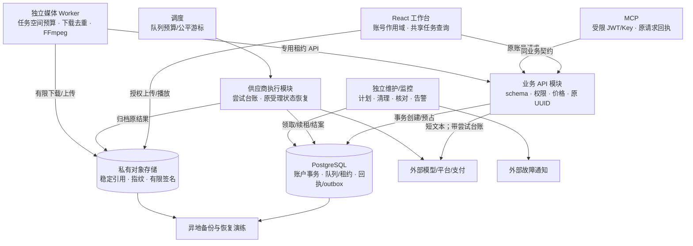

# 当前项目全面分析与优化方案

分析日期：2026-10-25。源码基线：`master@9099386`，项目为 `shoproai`。状态：优化建议，尚未实施业务改造。本文依据源码、部署配置、本轮本地检查及隔离复现编写；云端最新运行状态、真实供应商调用、生产负载及价格未在本轮核验。

## 1. 结论与决策

项目已经形成商品 → 脚本 → 媒体生成 → 剪辑 → 发布 → 数据反馈的执行链，并有积分事务、租约队列、私有素材、运营权限、现金退款和恢复机制。当前主要问题是部分入口的正确性、版本与部署落差，以及持续迭代产生的维护和运行成本。建议保留现有技术体系，先修复已经复现的问题，再完成可重复发布、任务执行隔离与容量验证。

优先级按业务影响定义：P0 为启用相关能力前必须修复的正确性问题；P1 为稳定运行和持续交付的基础；P2 为有测量依据后推进的性能及维护优化。这里的 P0 不代表本轮已发现生产事故。

| 顺序 | 优化重点 | 预期结果 |
| --- | --- | --- |
| 1 / P0 | 审核严格解析、真实图像证据、脚本输出与落库校验、异步账号固定、限流故障策略 | 避免错误放行、空结果成功和回执归属错配 |
| 2 / P1 | 单一依赖基线、CI、全栈版本清单、目标环境升级验收 | 每次交付可复现，源码与部署状态可核对 |
| 3 / P1 | 生产执行与维护任务分开、队列公平预算、完整模型调用台账 | 减少空轮询和故障扩散，费用能核对到真实调用 |
| 4 / P1–P2 | 共享任务查询、持久回执、剪辑页拆分、媒体下载去重与资源预算 | 降低请求、内存和修改成本 |
| 5 / P1–P2 | 外部告警、异地备份、恢复演练、数据库执行计划与容量基线 | 有能力发现、解释和恢复故障，按实测决定扩容 |

**架构决策：建议采用“按业务划分模块 + PostgreSQL 持久队列 + 独立媒体执行进程”，继续使用现有 React、Deno 和 Supabase 契约。** Redis、微服务、Kubernetes、框架大版本迁移不作为本轮默认优化。单台 ECS 可以成为运行载体，但完整自托管仍需要迁移适配与验收，购买服务器本身不能交付相同功能。

责任约定：下文“前端、后端、数据库、运维、测试”是建议责任角色，实际人员尚未指定；单人维护时由项目维护者承担，并以列出的检查路径留存结果。分析主要采用 `architecture-decisions` 决策框架，置信度高；容量和成本相关结论标为待测或估计。

## 2. 分析范围与证据边界

### 2.1 已覆盖的范围

前端路由、认证和账号作用域、业务 API 与任务 Hook、AI 统一入口、模型适配、资金和运营 SQL、生产调度、FFmpeg Worker、MCP、迁移部署工具、备份恢复工具及当前主文档。

| 模块 | 当前规模或契约 | 分析含义 |
| --- | --- | --- |
| 前端 | `src` 共 195 个文件，其中 193 个 TS/TSX 文件、32,714 行 | 是有完整业务状态的应用，不能按单页演示方案处理 |
| 重点页面 | 剪辑页 5,209 行，首页 2,248 行，数字人页 1,160 行，脚本页 1,039 行 | 拆分应优先围绕业务状态和副作用 |
| Edge | 43 个生产入口，95 个 TypeScript 文件、7,662 行 | 统一共享契约和发布清单比继续复制入口逻辑更重要 |
| SQL | 62 个迁移文件、9,263 行；生产准备工具选择其中 60 个 | 迁移文件总数不等于目标环境已应用数量 |
| 全栈契约 | 00062 / probe22 / render4 / edit2，20 个模型槽 | API、SQL、调度与镜像必须匹配 |
| MCP | 59 个工具、19 类权限 | 应复用业务 API 和身份规则，不能形成第二套计费与任务状态 |
| 运行形态 | SPA + Auth/DB/Storage/Edge + 常驻调度 + 独立 FFmpeg | 静态前端、外部模型与本地媒体计算的资源特征不同 |

已有且值得保留的设计包括服务端账户锁与原流水补偿、`FOR UPDATE SKIP LOCKED`、租约/checkpoint、未知受理禁止盲目重发、私有素材稳定引用、账号级 QueryClient 和模型不可变版本。优化不应破坏这些约束。

### 2.2 证据等级

| 等级 | 本文用途 | 能证明什么 |
| --- | --- | --- |
| E1：实际源码与配置 | 文件、调用、事务、资源限制 | 能证明当前实现形态；不能证明线上流量或可利用性 |
| E2：本轮隔离运行 | 实际处理器配受控 SDK/fetch、临时 PostgreSQL | 能证明指定输入和故障条件下的行为；不能证明真实商户或供应商端到端成功 |
| E3：历史环境记录 | 2026-10-22 部署与状态文档 | 只说明该时点回执，不代表 2026-10-25 云端现状 |
| H：优化假设 | 目标预算、容量、成本、收益 | 必须通过后续实测验证，不能当现有能力或 SLA |

### 2.3 本轮运行结果

| 检查 | 结果 | 边界 |
| --- | --- | --- |
| `npm run build` | 通过；最终复核构建 5.83 秒 | 构建成功不等于业务成功 |
| `npm run typecheck` | 通过 | 不替代运行时验证 |
| `npm run lint` | TypeScript 与 Biome 阶段通过，Biome 检查 197 文件；整体未通过 | `ast-grep` 缺失，规则阶段退出 127，后续 Tailwind 与检查构建阶段未运行 |
| `npm run test:finance` | 33 个真实 PostgreSQL 测试通过 | 本地临时数据库，不是生产库 |
| `npm run test:operations` | PostgreSQL 9 个、运营接口 4 组、视频 17 个、生产 7 组、AI 计费 7 个通过 | 测试覆盖现有契约，不覆盖本文新发现的全部异常 |
| `npm run test:scheduler` | 调度 11 个、数据库调度 4 个通过 | 不证明生产吞吐与长时间公平性 |
| `npm run test:volcengine` | 部署工具 10 个、协议 4 组通过 | 未创建云资源，也未执行云端升级 |
| 审核/脚本/限流隔离复现 | 确认三类不符合预期的返回 | 实际 Edge 处理代码，SDK/网络受控替代 |
| 配音账号切换隔离复现 | 确认 A 账号回执与 B 账号创建请求错配 | 实际前端封装，未发生真实扣费 |

本轮日志与复现摘要在本地忽略目录 `.volcengine-build/analysis-20261025/`，其中 `build.log`、`operations.log`、`scheduler.log`、`deployment.log`、`edge-findings.json`、`audio-identity.json` 可复核。主要结果已写入本文；该目录不随 Git 报告交付。其他历史测试见 [2026-10-22 测试报告](TEST_REPORT_20261022.md)，不计入本轮新验证。

没有启动长期应用或调度服务，没有对生产数据库、支付、供应商进行写操作。全量浏览器回归、长素材压力、真实外部 API 与恢复目标仍待验收。

## 3. 正确性问题与优先修复

### F01 / P0：审核结果类型不严，图像审核缺少真实图像证据

- **证据：E1 + E2。** `supabase/functions/ai-assistant/index.ts:837–863` 把图片 URL 路径描述作为文字传给文本模型；没有提交图片字节或视觉输入。`Boolean(parsed.pass)` 会把字符串 `"false"` 转为 `true`。
- **已复现结果：** HTTP 200，`pass: true` 与 `result: "reject"` 同时返回，模型调用一次，未传图像字节。不能将它当作可靠图像审核。
- **修复：** 仅接受布尔值 `pass`、受约束枚举与有限数值；`pass/result` 必须一致，字段缺失、类型错误、语义冲突均进入待复核。图片先核对本人素材、受控读取和大小/格式，再调用有实际视觉或图像审核能力的接口；没有该能力时明确待复核。
- **验收：** 对 `"false"`、缺字段、空 JSON、冲突判定、超时和未读取图片的用例，放行数为 0；至少一组真实图片用例证明审核输入包含实际图片且保留素材指纹。先检查所有使用审核返回值的入口，再启用相关能力。

### F02 / P0：四层脚本生成允许无有效分镜和保存失败仍成功

- **证据：E1 + E2。** `ai-assistant/index.ts:732–767` 解析失败保留空数组，整体 Prompt 可以为空；`scripts.insert` 的 `{ error }` 没有核对。
- **已复现结果：** 模型返回不符合格式的内容、数据库返回写入错误时，仍 HTTP 200，`scenes.length = 0`、Prompt 为空。
- **修复：** 明确定义分镜 schema、数量、顺序、正时长和字段上限；返回模型内容必须通过结构及业务校验。关键保存成功后返回脚本 ID。同步文本生成需要原请求 UUID 和结果回执，以便“模型已完成但保存失败”从原结果恢复；不能靠客户端重新生成解决。
- **验收：** 空分镜、错误类型、超长字段、数据库失败不能返回“已保存成功”；保存回执丢失后查询原请求能得到同一脚本，不产生第二次模型调用或第二次扣费。明确拒绝才按原流水补偿，未知状态保留原证据。

### F03 / P0：异步配音入口未固定发起账号

- **证据：E1 + E2。** `apps/web/src/services/audio/index.ts:24–51` 先生成账号回执键，再等待价格查询；创建和后续查询没有传入原 `expectedUserId`。
- **已复现结果：** A 账号生成回执键 → 等待价格期间切换至 B → B 身份创建请求；原账号回执和请求主体不一致。此复现没有真实扣费，也不等于已证明数据库 RLS 越权。
- **修复：** 操作开始时捕获账号、代次和请求上下文，价格、上传、创建、查询与迟到响应都核对原身份。复用现有 `accountSession` / `productionRequest` 的约束，回执绑定原账号；账号切换后中止后续步骤。
- **扩展检查：** `apps/web/src/api/videoJobs.ts`、`apps/web/src/api/materialAssets.ts`、`MediaJobsPanel` 等还有未普遍固定原身份的异步入口，需要逐一验证，不能直接把配音复现结论推广到全部入口。
- **验收：** 在价格、上传、提交和查询阶段分别切换账号；新账号收到的旧操作创建请求和旧结果写入均为 0。原账号再次登录可查询原任务，不能误清另一个账号的回执。

### F04 / P0：持久限流不可用时继续调用付费外部资源

- **证据：E1 + E2。** `ai-assistant/index.ts:48–72` 在数据库 RPC 报错时回退进程内 Map。本轮让持久限流失败后，处理器仍 HTTP 200 且调用模型一次。
- **影响：** 多实例或冷启动时内存计数不具有统一预算。原子积分扣费仍有数据库约束，不能据此宣称积分可以被绕过；但免费文本、审核等入口仍可能消耗供应商费用。
- **修复：** 对需要外部模型的入口，限流状态未知返回可恢复的 503，不调用供应商；把“确实超限”和“依赖不可用”分成不同结果。对不产生外部费用的读取才定义有界降级策略。明确免费操作也需要调用次数和现金预算。
- **验收：** RPC 异常、超时与多实例测试中，计费外部调用数为 0；确定超限返回 429，限流依赖异常返回 503。恢复查询和退款不因新任务限流被禁止。

### F05 / P1：同步模型调用台账无法完整接入成本核算

- **证据：E1 + E2。** `ai-assistant/index.ts:282–300` 支持 provider/model，但成功调用 `:489` 未传；复现中两者为 NULL。`supabase/migrations/00056_operations_workflows.sql:57–60` 的成本工作负载视图过滤掉 provider 为 NULL 的调用，`:331–338` 成本登记也依赖供应商归属。
- **影响：** 一次业务成功记录不能表达主备模型的多次真实尝试；免费操作也可能有现金费用。积分消费、供应商现金成本和估计成本必须分开。
- **修复：** 文本适配器返回/记录配置版本、provider、model、attempt、上游请求标识、状态、token usage、耗时；每次实际尝试单独追加台账，用业务 request_id 聚合。缓存命中单独记录，不伪造供应商调用。失败台账通过原 UUID 的 outbox 或待补录机制恢复。
- **验收：** 主失败备成功对应两条尝试；免费操作有调用台账；原供应商账单可按币种、配置版本及原调用核对。未知现金成本显示“未核对”，不能写成 0；积分和现金补偿不混记。

## 4. 前端与任务体验优化

### 4.1 共享任务查询与持久回执

`apps/web/src/hooks/useProductionJob.ts:14–16` 吞掉 localStorage 写入异常，仍允许提交；内存中存在原 UUID，但刷新后可能丢失恢复线索。`:52` 即使终态也每 10 秒继续恢复，回执为空时重新请求整个任务列表。部分任务面板每 5 秒独立轮询，取消、页面可见性和账号边界没有统一策略。

建议把现有账号级 React Query 用到任务状态，按 `(account, kind, job_id/request_key)` 共享读取；任务中心负责列表，详情负责单任务。活跃任务轮询按类型设置，终态停止，页面隐藏退避，重新可见立即回源。Realtime 只作为状态变化提示，断线后仍查询数据库权威状态，不把它做成不可替代的执行条件。

写操作继续使用原 UUID。回执写入必须有可检查结果：先持久保存，失败则停止新提交并提示恢复方式；或者实现可按账号查询的服务端预提交回执。不能只把存储从 localStorage 换成 IndexedDB 就宣称问题消失，两者都需要失败分支。

**验收：** 同账号多面板对同任务只保留一个共享查询；任务终态自动轮询为 0；隐藏页面 10 分钟的请求数较当前同用例减少至少 80%（建议目标）；刷新、存储失败、账号切换、提交响应丢失均能解释原请求归属，不能产生重复提交。

### 4.2 剪辑页按状态职责拆分

剪辑页 5,209 行、34 个 effect，存在时间轴、素材、预览、工具面板、项目保存和任务等多类状态。已有素材/录音/音轨组件，进一步拆分应从状态和副作用入手，避免只是把 JSX 移到几个大文件。

| 边界 | 建议职责 | 约束 |
| --- | --- | --- |
| 工程状态 | 时间轴数据、选区、撤销重做、工程 schema | 纯状态转移可测试；媒体对象不整体深拷贝 |
| 播放与预览 | 播放时钟、seek、媒体同步、释放 object URL | 高频时钟只影响需要的视图，拖动不重渲染整个工作台 |
| 工程读写 | 保存、防抖、版本冲突、原账号与迟到结果 | 通过现有 API；离页取消不能误报已保存 |
| 素材与音频 | 上传、缓存、录音、音轨编辑 | 沿用当前私有引用与缓存上限 |
| 后台任务 | 原回执、渲染/分析状态与恢复 | 复用共享任务查询，组件不另建定时器 |
| 页面布局 | 布局、快捷键、焦点与面板组合 | 逐块替换，不同时改工程格式和渲染契约 |

先抽取一条稳定路径并记录现有行为，再逐块迁移。建议页面最终只保留组合逻辑，单文件超过约 800 行或拥有多类异步副作用触发拆分检查；这是维护阈值，不是运行性能证明。首页可继续把商品选择、脚本/分镜、作品预览和任务恢复归回现有业务组件。

### 4.3 构建与实际性能分开评估

本轮 Vite 输出：剪辑 chunk 171.82 kB / gzip 50.36 kB，首页 89.00 / 25.92，MeasurementDashboard 398.19 / 111.62，xlsx 429.02 / 143.08。按静态 import 去重估算，应用启动 JS 约 553 kB，逐文件 gzip 约 168 kB；落地页加直接依赖约 569 kB / 175 kB。该估算不含 CSS、图片、动态加载、缓存与网络耗时。

已有路由懒加载和公共依赖分包，不能把大页面源码或单个 chunk 等同于“首屏很慢”。优先保持报表图表按页面加载、xlsx 仅导出时动态加载；在实际路径确认重依赖后再拆分，不盲目增加 vendor chunk。

建立固定移动设备、桌面设备和网络条件的冷启动/热启动基线，测量 LCP、INP、CLS、JS long task、内存与任务请求数。建议真实用户指标目标 LCP ≤ 2.5 秒、INP ≤ 200 毫秒、CLS ≤ 0.1；当前均未知。移动剪辑应对低内存、后台切换、录音中断、签名过期和导出等待提供明确恢复状态。

## 5. 后端、AI 与生产调度优化

### 5.1 把维护工作移出每次任务执行

`supabase/functions/production-worker/index.ts:99–111` 每次 `run` 在领取前串行执行 7 个计划/留存 RPC，其中任意一项失败可阻止后续所有任务。`:114–126` 有 21 类 runner，以当前秒数取模作为起点；能改变顺序，但没有持久公平性或长期吞吐证明。当前调度默认 10 秒、最多 4 并发。

建议保留现有队列表和领取事务，先增加清晰的运行类别：

| 类别 | 建议机制 | 故障影响 |
| --- | --- | --- |
| 任务执行 | 按队列组独立领取预算与并发上限 | 某供应商故障仅影响相关队列 |
| 业务计划 | 按到期计划与原 UUID 入队，单独调度 | 计划故障告警，不阻止已入队图片/视频 |
| 留存与删除 | 独立低频维护租约，小批次、限时执行 | 不将清理失败传播为全部生产任务失败 |
| 退款/交易核对 | 原商户/原流水查询，独立最低执行预算 | 长媒体任务不能使资金核对长期饥饿 |
| 监控 | 沿用独立 monitor，增加队列组状态 | 监控异常不触发重复供应商请求 |

持久游标或明确加权轮转在数据库事务内更新，保留全局上限及租约 fencing。并发额度可先按“视频/图片、文本与媒体、发布/资金、维护”分组，再依据真实服务时间调整；不同时引入新消息中间件。

**验收：** 注入留存 RPC 故障时图片和视频仍能领取；退款组有可验证的最低服务机会；空队列无供应商调用；以连续压力与并发调度测试比较每类队列最老等待时间，不仅检查 runner 顺序。UNKNOWN 不释放占用、不自动重提。

### 5.2 探针按用途拆分

`production-worker/index.ts:30–76` 的全量 probe 有 46 个串行数据库读取/调用。把它当频繁存活检查会增加延迟和数据库往返；它本身不领取或调用模型，这一点应保留。

建议区分进程存活、轻量运行就绪和发布能力预检。发布预检用单个 capability RPC 返回迁移、函数能力及 render/edit 契约，或有界并行独立读取；保留逐项失败原因。不得为加速而把“只检查表存在”当成全部业务能力可用。

**验收：** 发布预检仍检查同等能力并能指出缺失项；普通健康检查不执行 46 次全量查询，延迟和查询数有前后基线；数据库不可达返回不就绪。

### 5.3 AI 输出与依赖治理

以 F01/F02 为起点，将文本 action 拆成 schema、价格与权限、模型调用、结果校验、持久化几个明确模块，共用适配器；没有第二个调用者的功能保持直接实现。同步短文本可以保留请求响应或 SSE，长内容与需要保存恢复的任务优先沿现有持久队列。

为脚本、翻译、图片编辑、语音、知识引用建立版本化样本集，包含商品事实、禁止编造、语言、结构和原资料引用。先选择影响生产的 30–50 个样本作为建议起点；真实模型评估与协议替身测试分开，评估数据不能保存生产秘密。

模型变更必须有配置版本、输入 schema 和 Prompt 版本。主备降级需要调用台账和总超时预算；未知受理的生成类 POST 沿用当前不盲重发规则。缓存包含账号、配置/Prompt 版本、知识版本和完整规范化输入，配置变更后不继承旧结果；共享缓存必须先证明输入不含私有上下文。

**验收：** 结构错误率、事实错误、引用完整性、P50/P95 延迟、token 与现金成本可按版本比较。建议结构必需字段通过率 100%；质量改善目标在首轮真实评估后确定。

## 6. PostgreSQL 与数据维护

### 6.1 先测执行计划，再改变数据结构

当前账户与队列事务已经使用锁和索引。运营深页的 OFFSET、包含式关键词搜索，以及知识检索的 float 数组精确余弦扫描是容量候选项，不是已证明的慢查询。知识当前边界约 200 条 × 24 块 × 1,536 维，不代表实际每次都扫描满额。

在隔离数据库生成与当前约束一致的 1 倍、5 倍、10 倍数据，使用 `EXPLAIN (ANALYZE, BUFFERS)`、查询耗时和写入成本核对：

- 高频列表采用 `(created_at, id)` 游标，保留旧分页兼容路径；索引与 owner/状态/排序契约一致。
- 有实际关键词搜索需求且包含搜索成为瓶颈时，比较 trigram/全文检索与当前查询，不能随意给所有文本列加索引。
- 知识数据超出现有有界扫描或 P95 超出预算时，再验证目标数据库的 pgvector 扩展、维度、模型版本隔离和索引召回。迁移先双读比较，记录引用一致性和召回差异。
- 队列索引以实际领取的状态、`next_poll_at`、租约条件为依据；检查死行、VACUUM、锁等待和任务事件留存。

建议初始预算：在约定负载下，普通本人列表 SQL P95 ≤ 200 ms、任务创建 API P95 ≤ 2 秒（排除外部模型生成）、知识检索 P95 ≤ 500 ms。这些是待验证目标，不是本轮性能结果。

### 6.2 整理事务入口与迁移演进

迁移累积了多层 `before_*` 重命名包装，能保留兼容但增大资金、团队和权限规则追踪成本。先输出当前函数调用图与锁顺序，明确唯一外部入口、内部权限和 RLS，再通过新迁移收敛已验证逻辑；不修改历史迁移，不删除尚有调用的旧函数。

每次涉及资金、团队或任务的迁移必须同时验证空库全量迁移与受支持旧版本升级。新计费入口保留 00057 的 `套餐行 → 用户团队锁 → 用户风险锁 → 团队行`，现金退款保留既有 `账户 → 订单 → 退款` 顺序，分别验证各自交叉调用，不用笼统抽象替换已经验证的死锁修复。恢复和退款需要独立于“允许创建新工作”的限制。

验收保留原请求、逐笔资金、并发预算、租约和授权测试；新增结构必须经过 `pg_proc`/权限核对、旧数据回填与执行计划检查。大型索引变更独立于业务发布并记录所需锁和回退方式。

## 7. FFmpeg 与 MCP 运行优化

### 7.1 下载去重与临时空间预算

`services/media-worker/main.py:115–121` 对每个轨道下载素材，同一 URL 可重复下载，工程输入合计上限 2 GB。`services/media-worker/render.py` 还允许人物蒙版合计 768 MB、输出约 1 GB；`infra/render-worker/docker-compose.yml` 同时设置 4G tmpfs 与 4g 容器内存。

tmpfs 消耗内存，输入、蒙版、输出加上 FFmpeg/模型工作集会竞争同一资源。现有文件上限不能证明峰值内存安全；本轮未实测 OOM。

建议按受信任稳定媒体引用及素材指纹做**单任务**下载去重，轨道复用本地文件。不要建立无归属的跨账号 URL 缓存，也不要仅凭可变外部 URL 认定内容相同。将大媒体临时目录改成有磁盘配额、任务结束清理的挂载，启动前核算输入/输出/蒙版/安全余量；不足则先拒绝领取或暂停，不在下载完成后才发现空间耗尽。

增加 init、健康信号、优雅退出时间、日志轮转和独立资源限制；当前非 root、只读根、cap drop 和专用租约密钥继续保留。退出时按原租约保留证据，不把终止信号直接解释成供应商明确失败。

**验收：** 多轨同素材只下载一次；连续不同账号任务缓存不会串用；1080p/4K、音轨、蒙版组合记录 RSS、临时盘峰值、CPU、实际时长与失败原因；终止/磁盘满/上传响应丢失后从原租约恢复，无重复模型调用。

### 7.2 MCP 与运行权限

当前 MCP Compose 监听 `127.0.0.1:8080`，这是已有边界；容器尚缺资源限额、只读根、cap drop 等运行约束。应补充 CPU/内存/PID/超时、健康检查、日志上限和受控秘密文件；若对外开放，仅经有认证与 TLS 的代理，不直接暴露服务端秘密。

工具继续走统一业务 API，保留按请求 ContextVar 隔离、工具权限、原 UUID 和 POST 不自动重试。增加多用户并发隔离与代理断线测试，工具目录由导出工具校验，避免目录数量和实现漂移。

**验收：** 59 工具/19 权限目录与实际导出一致；拒绝越权的调用不触发供应商；并发请求、取消和重连不混用 JWT/Key；本地 stdio 和 HTTP 均沿原业务回执恢复。

## 8. 依赖、CI 与发布

### 8.1 单一可复现依赖基线

仓库同时有 npm/pnpm 锁文件，声明 `pnpm@10.34.5`，当前两份锁中的 Router 解析版本存在差异（npm 6.30.6、pnpm 6.30.4）。前端 Supabase SDK 固定 2.103.1，而 Deno 侧广泛使用浮动 `npm:@supabase/supabase-js@2` 且未发现统一 deno.lock；Python/PG 基础镜像也只有浮动大/次版本标签。

建议以声明的 pnpm 为默认，在干净环境重新核对生产构建与部署脚本后保留一份权威锁，统一 CI 和文档；需要 npm 发布工具时明确工具边界。Deno 和镜像分别固定依赖解析与镜像摘要，记录 Python 依赖和人物模型摘要。定期小批升级，保留回退产物，不运行无差别 `audit fix --force`。

本轮 production audit 报告 7 个受影响包，其中 xlsx 0.18.5、zod 3.25.76 有 high 等级版本公告，Router/PostCSS/Tailwind 有 moderate 公告。这是版本告警，不是本轮可利用漏洞结论：

- xlsx 当前用于动态导出，未发现解析上传工作簿的入口；仍建议评估移除或换用持续维护的导出库，验证中文、公式/文本安全和大表内存。
- 未发现业务源码调用 zod；核实直接/间接使用后可移除无用直接依赖，或兼容升级。
- Router 相关 SSR 公告不应直接套到当前 BrowserRouter SPA；各公告按实际使用路径处理。

### 8.2 CI 最小交付链

仓库没有 `.github` 自动检查流水线，部分本地检查依赖工具未锁定。先把现有有意义的检查放进干净环境运行，再扩充新发现异常的回归用例。

| 触发 | 检查 | 失败处理 |
| --- | --- | --- |
| 每次 PR/提交检查 | 权威锁安装、typecheck、Biome、固定 ast-grep 规则、生产 build | 阻止合并；缺工具不能跳过标绿 |
| 按改动路径 | 资金/权限/任务 SQL、对应 API、MCP 导出或 Worker 测试 | 保留临时 PG/镜像版本和失败日志 |
| 迁移与发布变更 | 空库迁移、旧库升级、函数契约、probe 与镜像版本核对 | 不发布不兼容组合 |
| 计划运行/发版前 | 账号切换、任务未知恢复、支付回执和媒体端到端回归 | 异常回到对应能力；不把模拟成功当真实商户成功 |
| 依赖升级 | 公告可达性核对、构建变化与受影响协议 | 小批升级并保留可回退版本 |

SQL 测试使用临时数据库并自动清理；外部模型真实评估使用专门环境和预算。CI 不携带生产 service_role、商户密钥或真实用户素材。不要为每个简单 JSX 搬迁增加镜像实现的测试，重点保护账号、资金、状态机和恢复约束。

### 8.3 发布清单与灰度

生成一份机器可读发布清单：Git SHA、生产迁移集合/摘要、全部函数入口/共享模块、probe/render/edit 版本、MCP 工具/权限摘要、前端产物、镜像 digest 和启用能力。统一发布工具校验，文档引用该清单，减少人工复制数字。

升级顺序沿当前运行手册：备份并验证 → 控制新提交与供应商受理 → 兼容迁移 → API/镜像/配置 → 只读能力探针 → 唯一调度 → 最小真实业务 → 前端/MCP。逐能力启用并观察原请求恢复与费用，不能同时更换数据库、存储、模型和前端行为。

前端/API/Worker 可回退到匹配产物；数据库优先向前兼容迁移，不能随意删除已产生业务记录的新表。切换前必须明确进行中的原任务由哪个环境继续查询，避免两个调度各自重提。

## 9. 安全边界、观测与恢复

### 9.1 凭据轮换与网络边界

现有模型凭据使用 AES-GCM，任务绑定配置版本；当前加密封装缺少明确 `key_id` 和标准轮换工具。建议密文记录算法/密钥版本，解密可读受支持历史密钥，加密只用当前密钥；受控批量重加密先预检和抽样，备份回执包括所需历史版本。没有恢复成功的验证不能退役旧密钥。

Worker 已有公网 HTTPS、禁止重定向及 DNS 内网校验。DNS 校验与实际请求的解析/连接分离仍是待验证的边界，应采用固定可信存储来源与受控出口，或连接时绑定已验证目标；自托管内网访问必须使用单独受约束的服务策略，不能全局取消安全校验。本轮没有证明 DNS 重绑定可利用。

RLS、service-only RPC、平台 Key 受限读取及专用 Worker 秘密继续保留；对新增恢复入口验证原账号与权限，不把签名 URL 视为可立即撤销的授权。

### 9.2 观测与成本

已有持久内部告警和独立 monitor，应补全外部通知、交接责任与完整关联链。结构化事件以 request_id/job_id、租约代次、配置版本、调用 attempt 关联；日志不记录 JWT、秘密、完整签名 URL、用户原文和全量素材。

最小监控面板包括每类队列深度/最老等待、租约丢失与 UNKNOWN、创建与恢复成功、各供应商尝试/超时/降级、台账待补录、现金成本未核对、DB 锁等待、Worker CPU/RSS/磁盘、清理积压和最近恢复时间。告警阈值由初始真实基线调整。

建议未启用能力不产生持续值班告警；调度停止、台账积压、资金核对超时和备份过期分别有责任角色及原对象处置路径。通过状态事务产生用户通知，不能从页面轮询猜测成功后补造。

### 9.3 备份与恢复

已有加密快照、对象映射、历史密钥与隔离恢复工具，历史双 PG16 测试证明本地方案的一部分。缺口在目标环境调度、异地保管、托管元数据差异、真实恢复时间与外部故障通知。

建议数据库持续/定期备份与对象版本/清单共同保管在独立故障域；原 UUID、模型配置历史、任务证据和密钥版本必须能一起恢复。明确谁能解密、如何拿到历史密钥、保留期和恢复目标。备份文件在同一 ECS 数据盘不构成灾备。

建议试点目标为 RPO ≤ 24 小时、RTO ≤ 4 小时；进入付费生产前评估数据库 WAL/PITR 和对象保存策略后再收紧目标。实际值必须通过目标环境空库/空存储恢复、文件 hash、历史解密和原任务查询演练测得，不能仅用“备份命令退出 0”验收。

## 10. 目标架构与部署选择

### 10.1 目标系统图

Auth/JWT 是浏览器/MCP 到业务 API 的身份边界，数据库事务是资金与任务状态的权威边界，模型/平台适配器是外部数据转换边界，FFmpeg 只持专用租约密钥。图中的模块不代表都需要独立微服务；只有媒体计算、调度与必要维护进程需要运行隔离。

### 10.2 业务边界与交互决策

| 上下文 / 责任路径 | 模型与数据 | 上游与下游关系 | 转换与约束 |
| --- | --- | --- | --- |
| 身份 / `AuthContext`、`accountSession` | 账号、JWT、代次 | 认证服务为上游；所有客户端操作遵循其身份，属 conformist | 将 SDK 会话转换为固定请求上下文 |
| 资金权益 / finance SQL | 原 charge、套餐、预算、现金交易 | 业务创建使用其事务规则；属 shared kernel | 供应商现金与内部积分分别核算 |
| 内容与工程 / pages、业务 API | 商品事实、分镜、工程、素材引用 | 使用身份/资金；生成任务与发布为下游，customer/supplier | 模型文本经 schema 转换为可保存业务对象 |
| 任务执行 / queue SQL、worker | UUID、租约、checkpoint、状态 | 内容模块入队，执行器遵循持久状态；共享任务契约 | 平台/模型适配器为 anti-corruption layer |
| 私有媒体 / Storage、素材 API | owner、稳定路径、hash、引用/墓碑 | 内容/任务共用引用规则，shared kernel | 外部结果先归档再结案；签名只是传输凭据 |
| 运营观测 / operations、monitor | 可信角色、原对象、告警、成本尝试 | 消费业务事务与执行证据，customer/supplier | 不把运行估计转换成实际经营指标 |
| Agent 接入 / MCP | 工具、权限、原请求预算 | 遵循业务 API，conformist | 把工具输入转换为同一 API schema，不复制计费 |

交互保留短文本请求响应/SSE、长媒体持久任务和分批执行。客户端用共享查询加变化提示；服务端执行不依赖页面存活。维护使用低频独立批次。全面同步调用会加重超时歧义，纯推送又增加断线恢复依赖，因此采用数据库权威状态与原回执恢复。

### 10.3 架构选择 ADR

决策问题：如何在不损失现有资金、身份和恢复约束的前提下，提高可交付性并控制运行成本？

| 驱动因素 | 优先级 | 依据 | 取舍 |
| --- | --- | --- | --- |
| 原任务和资金正确性 | 最高 | 已有事务/租约，且有入口复现问题 | 先修复与验收，重写不能替代正确性证明 |
| 有限维护与运维能力 | 高 | 多技术运行面、尚无 CI | 先统一契约和自动化，减少分布式组件 |
| 媒体与 API 资源差异 | 高 | FFmpeg 临时盘/CPU/内存限制 | 媒体独立运行，按容量决定是否独立主机 |
| 可迁移性与费用透明 | 中 | 强依赖 Auth/RLS/Storage/Edge | 迁移分阶段，承认自托管运维成本 |

| 选项 | 优点 | 代价/风险 | 建议 |
| --- | --- | --- | --- |
| 保持当前形态不改 | 无改造成本 | 已确认入口问题和部署差距持续存在 | 仅可暂时禁用未验收能力 |
| 现有模块化体系 + 托管基础服务 + ECS 执行 | 保留身份/数据契约，媒体可单独扩容 | 托管和宿主机两套运行责任 | **默认推荐**；先修 P0 和发布链 |
| 单台 ECS 自托管 Supabase 全栈 | 资源可控，减少平台分散 | Auth/Storage/Edge/Realtime/备份都需运维，单点与资源竞争 | 低负载试点选项，验收后再迁移 |
| 普通 PostgreSQL + 自建 Auth/Storage/API | 技术自主性高 | 替换 SDK/RLS/RPC/签名/OAuth 会产生大量兼容工作 | 当前无充分收益支撑 |
| 立即拆微服务 + Redis/Kubernetes | 可以独立扩展部分模块 | 网络一致性、发布、告警与值班成本显著增加 | 达到明确独立扩展/隔离需求后再决策 |

状态：建议方案，未执行。正面后果是复用已验证的业务约束、媒体可隔离、部署选择保持可逆；负面后果是仍有 Supabase 耦合，数据库兼具业务和队列负载，完整自托管需要运维能力。

模块拆分、查询共享和执行预算是可逆决策；Auth/Storage 与生产数据迁移属于高回退成本决策。改变部署选项需重新核对配置、进行中任务和备份；改变核心 API/资金模型需旧客户端兼容与数据迁移。重新决策触发条件：数据库领取/业务延迟持续超预算、媒体资源长期挤占交互、平台约束阻止所需能力，或出现明确独立发布/责任需求。

### 10.4 一台 ECS 实现相同功能的条件

如果优先落地，ECS 先运行调度、FFmpeg/MCP，前端使用静态托管，继续连接已验收的托管 Auth/DB/Storage/Edge，改动量较小。若要求全部集中到一台 ECS，则需要部署并匹配 Supabase 的认证、PostgreSQL/RLS/RPC、对象存储网关、API/Edge Runtime，以及已使用的 Realtime，不能只安装 PostgreSQL 和 Nginx。

| 事项 | 单机试点建议 | 验收边界 |
| --- | --- | --- |
| 规格 | 8 vCPU / 16 GB 可作为低并发试验起点；全栈加媒体建议同时评估 32 GB | 估计值，16 GB 不保证全部长素材能力；按资源总预算选择 |
| 媒体执行 | 先 1 个渲染任务，限制规格和时长，普通队列并发从低值起步 | 最大值需压测，不能照抄 4 并发到所有任务 |
| 临时盘 | 独立目录/卷、容量配额和水位，避免 4G tmpfs 与 4g 内存竞争 | 容量由输入/蒙版/输出预算和并发计算 |
| 持久数据 | 数据卷与临时盘分开，私有对象存储及独立备份目的地 | 本机磁盘快照不能替代数据库/对象一致性恢复 |
| 网络 | TLS、认证回跳、平台回调与存储签名地址；内部端口受控 | 现有 Worker 仅允许公网 HTTPS，内网地址需精确适配 |
| 模型 | 视频/图片/数字人继续调用外部接口 | 此模式不需要 GPU；本地模型训练或大模型推理另算 |
| 稳定性 | 健康检查、优雅退出、资源限额、日志轮转与外部故障通知 | 单机故障会同时影响全部服务，不称高可用 |

仓库目前有执行器/MCP Compose，但没有已验收的完整自托管 Compose、全部地址/认证适配和数据切换回执。自托管交付需要：空环境部署 → 60 个生产迁移及匹配函数 → Auth/账号与旧素材迁移 → 原任务恢复 → 支付/OAuth/SMS/SMTP/签名 → 功能对等测试 → 备份恢复 → 控制切换。

成本预算按实例/磁盘、对象存储/外网流量、数据库备份、日志监控、供应商调用和运维时间分别计算；本轮没有询价和用量，不给月费或节省比例。媒体公网流量、长任务失败重试与模型尝试次数可能比静态站点更影响成本。生产规模增大时优先把媒体 Worker 从业务/数据库主机拆开，再评估数据库和对象存储托管，不以“单机便宜”替代故障成本。

### 10.5 关键运行依赖与退出路径

| 依赖 | 故障模型 | 诊断/变更路径 | 降级与退出条件 |
| --- | --- | --- | --- |
| Auth/JWT | 会话不可用、回跳/刷新失败 | 账号代次日志、认证配置与本人快照检查 | 停止新敏感写，保留原回执；迁移须保持账号映射 |
| PostgreSQL | 不可达、锁等待、迁移不匹配 | SQL 计划/锁、迁移清单、能力 RPC、隔离恢复 | 不新提交或重提；恢复原状态后继续；按备份方案替换 |
| Storage | 签名过期、对象缺失、上传结案未知 | 稳定路径/hash、对象清单、原租约归档查询 | 刷新授权或恢复上传，不重跑模型；迁移验证对象映射 |
| 外部供应商 | 超时、受理未知、配额/配置变更 | 原请求/尝试/上游 ID、不可变配置版本 | 查原受理；明确失败才补偿；停用新任务不删除历史配置 |
| ECS/媒体运行 | 内存/磁盘/进程故障 | 健康信号、RSS/空间、原租约、镜像 digest | 停止领取，原证据恢复；媒体进程可移到独立主机 |
| Realtime/通知 | 断连、迟到、未送达 | 账号级订阅状态和原事件键 | 查询权威状态；外部告警另有发送/重试回执 |

## 11. 分阶段任务与验收

工作量为熟悉现有项目的工程师估计人日，包含必要回归但不包含真实平台审批等待、云端账号恢复和不可预期历史数据处理。角色可以由同一人承担，并行任务不等于人日可以直接转换为日历天。

| 阶段 / 任务 | 责任角色 | 估计人日 | 依赖 | 交付与接受条件 |
| --- | --- | --- | --- | --- |
| A1：F01 审核类型/图像证据 | 后端、测试 | 2–4 | 确认可用审核能力 | 无证据及冲突判定零放行，有输入指纹 |
| A2：F02 脚本 schema/原结果回执 | 后端、数据库 | 3–5 | 原 UUID 契约 | 无效/未保存不成功，原结果恢复不再调用 |
| A3：F03 身份与回执入口统一 | 前端、测试 | 3–5 | 账号作用域 | 各 await 切换账号零错误提交，原回执可恢复 |
| A4：F04 限流异常策略 | 后端、测试 | 1–2 | 操作费用分类 | 依赖异常零供应商调用，429/503 可区分 |
| **A 合计：正确性** | 项目维护者统筹 | **9–16** | 先保护受影响入口 | 本文复现转为回归测试，相关能力验收后启用 |
| B1：依赖/CI/版本清单 | 开发、运维 | 3–5 | 权威锁选定 | 干净环境完整检查，缺工具或版本不匹配不能标绿 |
| B2：F05 调用/尝试成本台账 | 后端、数据库 | 3–5 | 原业务 UUID | 免费和主备尝试完整，未核对成本可见 |
| B3：目标环境升级与最小对等验收 | 运维、测试 | 2–4 | 目标访问与备份；A/B1 | 匹配全栈、唯一调度、真实回执；不包含全部自托管 |
| **B 合计：交付基线** | 项目维护者统筹 | **8–14** | A 后可部分并行 | 有全栈发布清单和真实目标接受记录 |
| C1：队列/维护隔离与能力 probe | 后端、数据库 | 3–5 | B1 | 维护故障不阻塞生产，有公平/等待测量 |
| C2：共享任务查询与持久回执 | 前端、测试 | 2–4 | A3 | 终态零轮询，多面板共享，刷新和存储失败可恢复 |
| C3：媒体/MCP 资源与下载治理 | 后端、运维 | 2–4 | 原媒体引用/租约 | 同素材一次下载，峰值资源与退出恢复通过 |
| **C 合计：运行效率** | 项目维护者统筹 | **7–13** | B | 输出同负载前后请求/资源/等待基线 |
| D1：剪辑页/首页逐块拆分 | 前端、测试 | 4–7 | A3/C2 | 工程契约不变，交互与恢复回归通过 |
| D2：DB 与知识容量测量及必要优化 | 数据库、后端 | 2–4 | 固定数据集 | 执行计划/查询基线；只实施有证据的索引/分页 |
| D3：外部告警/异地恢复/文档生成 | 运维、开发 | 3–5 | B3/C | 实际故障通知和空环境恢复回执、发布清单入口 |
| **D 合计：维护与恢复** | 项目维护者统筹 | **9–16** | B/C | 有可重复容量与恢复证据 |

上述基本方案合计约 **33–59 人日**；最先交付 A 阶段，不能因为后续重构尚未完成而延迟正确性修复。若另选完整 ECS 自托管，额外估计 **5–10 人日以上**完成部署适配和迁移演练，历史数据、平台审核或目标限制可能增加工期；属于独立决策，不包含在 B3。

### 11.1 架构约束检查

| 属性 | 指标/规则 | 建议阈值 | 测量来源与检查路径 | 频率 | 失败响应 |
| --- | --- | --- | --- | --- | --- |
| 身份隔离 | 原账号与请求/结果归属 | 错配为 0 | `accountSession`、前端账号切换受控回归 | 相关改动/发版 | 阻止受影响能力发布 |
| 资金/受理正确性 | 原请求重放、UNKNOWN、逐笔补偿 | 重复扣费/未知自动重发为 0 | `test:finance`、`test:video`、对应 SQL 测试 | 相关改动 | 保留原回执，停止新执行 |
| 审核/输出 | 类型、证据与持久化 | 非法审核放行为 0，结构必需字段通过 100% | F01/F02 新回归、真实模型样本 | 每次模型/schema 变更 | 待复核或原结果恢复 |
| 依赖方向 | MCP/页面不得创建第二套关键写入 | 关键写全部经过已授权 API/RPC | API 目录与 `test:mcp` / 规则扫描 | PR/发版 | 拒绝旁路变更 |
| 公共契约 | 迁移/API/镜像及旧客户端兼容 | 支持版本兼容用例全通过 | 发布清单、`test:volcengine`、probe | 每次发布 | 不启动不匹配调度 |
| 交互延迟 | 非生成任务创建、本人列表、知识查询 P95 | 2 秒 / 200 ms SQL / 500 ms，待测 | 固定隔离数据/并发、EXPLAIN 与 API 延迟 | 首轮基线/容量变更 | 定位后降并发或优化 |
| 故障隔离 | 维护失败、队列等待、Worker 资源 | 无全部队列阻塞；等待/内存有预算 | `test:scheduler`、故障注入与媒体压力 | 调度/资源变更 | 停止领取受影响组 |
| 恢复 | 最近可恢复点与空环境耗时 | 试点 RPO 24 小时/RTO 4 小时，待验收 | `test:backup` + 目标环境恢复回执 | 目标变更/建议月度 | 修复备份后再扩大使用 |

现有命令是检查入口，不代表已经覆盖表中全部新增接受条件；实施阶段需要补齐相关回归与测量脚本。

### 11.2 风险登记

| 风险 | 可能性判断 | 影响 | 缓解 | 责任与复核 |
| --- | --- | --- | --- | --- |
| F01–F04 错误判定/回执/故障放行 | 指定条件下已复现，生产发生率未知 | 正确性和成本 | A 阶段逐条修复与回归 | 后端/前端，相关能力发布前 |
| 成本台账不完整 | 当前实现可确认，金额未知 | 无法核对经营费用 | F05 尝试级记录与补录 | 后端/财务运营，版本变更 |
| 维护故障阻断领取、长期公平未知 | 代码路径明确，运行频率待测 | 队列积压 | C1 隔离与压力检查 | 后端/数据库，调度变更 |
| 媒体资源竞争 | 配置风险明确，峰值待测 | Worker 失败/宿主机压力 | C3 盘/内存预算，低并发试点 | 运维，扩大规格前 |
| 最新源码与目标部署不一致 | 历史回执显示差距，本轮未刷新 | 功能不可用或契约冲突 | B3 只读核对后匹配升级 | 运维，真实发布 |
| 单机全栈故障 | 单故障域必然存在 | 全部服务同时中断 | 异地备份、外部告警、媒体可迁移 | 运维，ECS 决策时 |
| 依赖/密钥生命周期失控 | 锁/浮动版本证据明确，事故未知 | 不可复现或历史解密失败 | B1 固定依赖、版本化轮换 | 开发/运维，周期复核 |
| 无测量的重构扩大范围 | 实施阶段风险 | 工期和回归 | 按业务边界小步交付，保留旧契约 | 项目维护者，每阶段 |

## 12. 文档与后续决策

主文档同时叠加多个“当前/最新/上一轮”段落，容易混淆时点。建议 `CURRENT_STATE` 只保留真实环境、功能基线、最近回执和未接受事项；架构主文档保留当前图和约束，迭代过程归历史页；数量与契约从发布清单生成。每次验收同时标明源码、隔离测试、远端同步、目标部署四种状态。

本轮 E3 环境依据是 [当前状态](../../CURRENT_STATE.md)、[待部署与验收](../../PENDING_CHANGES.md)、[部署记录](../../releases/DEPLOYMENT_AIGCP.md)，其中官方成功回执停在旧 00031/三函数、最近管理访问 401 是 2026-10-22 记录，不能写成今天重新验证的事实。

下一步只需明确两个会影响后续架构的决策：采用托管基础服务还是完整 ECS 自托管；以及用真实目标负载测得的媒体/数据库容量是否要求分离主机。其余 A 阶段正确性和 B1 交付基线可按现有结构推进。

参考入口：[技术架构](../../architecture/TECHNICAL_ARCHITECTURE.md)、[综合发布基线](RELEASE_BASELINE_20261022.md)、[测试计划](../../testing/TEST_PLAN.md)、[运行手册](../../operations/RUNBOOK.md)、[备份恢复](../../operations/BACKUP_RECOVERY.md)、[火山部署方案](../../releases/VOLCENGINE_DEPLOYMENT.md)。本方案中的目标、估计和候选技术不修改这些文件中已有的实际验收状态。
